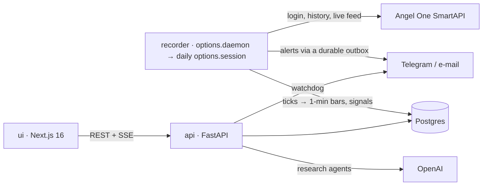

# TradingAgents India

A personal NIFTY index-options **signal tool**, plus an older multi-agent LLM stock-research pipeline.

- **Signals:** every 5 minutes, deterministic Python turns live Angel One market data into graded buy-only CE/PE signals. They are sent to Telegram (with e-mail as the fallback), tracked to their result on live bid/ask after all charges, and mirrored in a paper account.
- **No orders:** nothing in this codebase places, modifies or cancels a broker order. You trade by hand, at your own risk.
- **Personal use only:** this is not investment advice. Sharing the signals with others needs SEBI Research Analyst registration.

## How it fits together



| Path | What lives there |
|---|---|
| `options/` | Signal tool. `market_data/` records the feed. `agents/` holds the 12 analysis pillars plus the shock detector. `setups/` holds S1–S3 and P1. `engine/` does grading, sizing, lifecycle, controls and statistics. `notify/` sends alerts (outbox, Telegram, e-mail). `admin/` covers accounts, connectors, health and the watchdog. `backtest/` holds replay, the proxy backtest and ablation. |
| `api/` | FastAPI app: auth, signals, paper, operations, research. |
| `ui/` | Next.js App Router dashboard (SWR polling, Tailwind, Recharts). |
| `agents/`, `orchestrator/` | The 13-agent research pipeline (OpenAI). |
| `docs/` | `index-options-plan.md` (design), `options-runbook.md` (setup and deploy), `build-progress.md` (status and what's next), `review/` (the platform review). |

## Run it locally

Requirements: Python 3.12 and Node 20.9 or newer.

```bash
python -m venv .venv
.venv/Scripts/pip install -r requirements-dev.txt          # Windows; use .venv/bin/pip elsewhere
DATABASE_URL=sqlite:///data/options.db .venv/Scripts/python -m uvicorn api.main:app --port 8000
```

```bash
cd ui && npm ci && npm run dev                            # http://localhost:3000, calls the API through /api rewrites
```

On first start the API prints a one-time **setup code** in its log; use it in the browser to create the admin account. Every key (Angel One, Telegram, e-mail, OpenAI) is entered on the **Connectors** page and stored encrypted. Only `DATABASE_URL` (and optionally `SECRET_KEY`) live in the environment.

The recorder runs as `python -m options.daemon` (or `SERVICE_ROLE=recorder` in Docker). It starts a session at 08:30 IST on trading days.

## Tests and checks

```bash
.venv/Scripts/python -m pytest -q --cov=options --cov=api --cov-fail-under=85
cd ui && npm run lint && npm run typecheck && npm run build
```

CI (`.github/workflows/ci.yml`) runs the same on every push.

## Deploy (Railway)

Four services: `api` (root `Dockerfile`), `recorder` (same image, `SERVICE_ROLE=recorder`), `ui` (`ui/Dockerfile`) and Postgres. All of them run in `asia-southeast1`.

```bash
railway up --service api --detach
railway up --service recorder --detach
railway up ui --path-as-root --service ui --detach
```

Python packages install from `requirements.lock` and UI packages from `ui/package-lock.json`, so builds are reproducible.

For uptime monitoring, point an external monitor at `https://<api>/health/recorder`. It returns 503 while the recorder is down, hung or not running in market hours.

## Validating the setups

A setup goes LIVE only after its shadow record proves an edge. **Performance → Is the edge real?** shows each setup's 95% interval and the number of trades still needed. A LIVE setup goes back to SHADOW automatically when its last 30 trades average a loss after costs.

For years of history, run the proxy backtest (`python -m options.backtest.proxy`). It is labelled as a proxy, because historical open interest isn't available.
