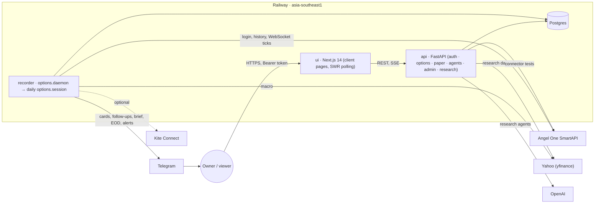
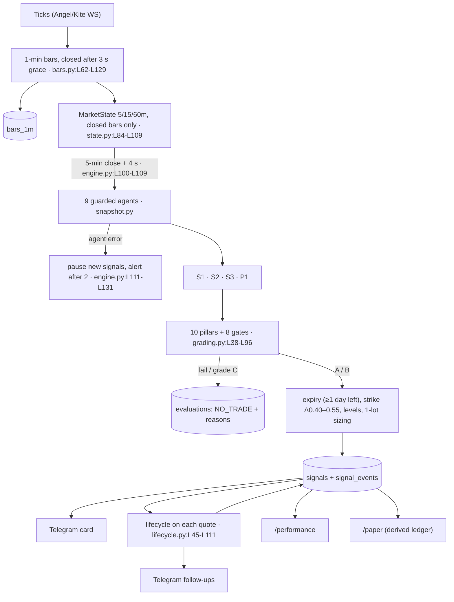
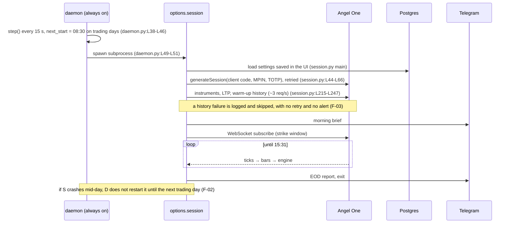
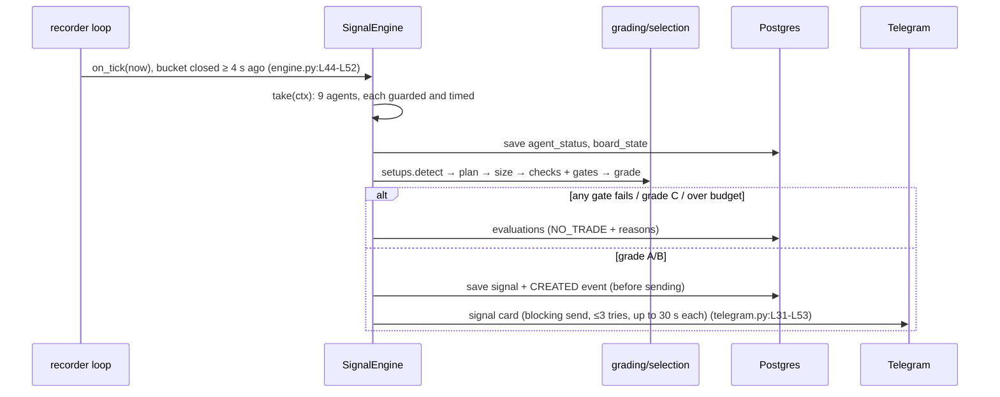
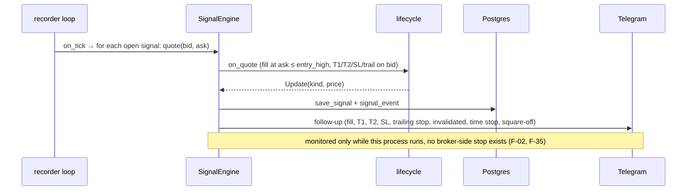

# Platform Review: TradingAgents India

**Review details:**
- **Scope:** branch `feature/options-signal-tool`, commit `c50cc78`.
- **Date:** 17 Oct 2026.
- **Method:** reviewer-run and read-only: no source file was changed, and no broker, LLM, paid data API or production database was touched.
- **Evidence format:** `path:Lstart-Lend`.
- **Tags:** [CODE] means verified in the code; [RESEARCH] means an external source (see §8). UNVERIFIED means not checked, and each one says what would check it.

**Supporting files:**
- Inventories with full evidence: [`_notes.md`](_notes.md).
- Scripts and raw output: [`scripts/`](scripts/).
- Screenshots: [`screenshots/`](screenshots/).
- UI detail: [`UI_REVIEW.md`](UI_REVIEW.md).
- Backlog: [`backlog.csv`](backlog.csv).

---

## 1. Executive summary

**What it is (INFERRED):** a personal **NIFTY index-options signal tool**. Every 5 minutes, deterministic Python code turns live Angel One market data into buy-only CE/PE signals. It sends them to Telegram, tracks each one to its result on live bid/ask after all charges, and mirrors them in a paper account. Next to it sits an older **13-agent LLM stock-research pipeline**. **No code path places, modifies or cancels a broker order** [CODE: `git grep` finds no order, GTT or positions call; `agents/execution.py:L1-L31` is explicitly simulated].

**Overall verdict:** the platform is **well-built and safe to run in SHADOW mode, but it is not yet proven, and it is not yet reliable enough to depend on for real-money exits.**
- **Engineering quality is high:**
  - 255 tests pass with 90% coverage.
  - The engine's indicators match TA-Lib.
  - A repaint test shows decisions use only closed candles.
  - Costs are modelled in full.
  - No LLM sits in the trading loop.
- **What's missing:**
  - **Evidence:** nothing has been recorded or backtested yet, so there is no proof that any setup has positive expectancy.
  - **Operational safety nets:** if the session crashes mid-day it isn't restarted; there's a single alert channel that drops failed messages; a failed warm-up is silent; and there's no kill switch or auto-demotion of losing setups.

**Use cases (31):**
- **Status:** **20 COMPLETE · 3 PARTIAL · 1 STUB · 7 PLANNED · 0 BROKEN · 0 ORPHANED**.
- **Mix:** 15 Core, 16 Supporting.
- **Verdicts:**
  - **SUFFICIENT:** 14.
  - **PARTIALLY SUFFICIENT:** 6.
  - **INSUFFICIENT:** 11 (3 implemented: UC-12, UC-13, UC-22; plus all 8 not yet built).

**Safe to run live today? No.**
- **There is no live order execution to switch on, by design.**
- **If "live" means trading real money by hand on these signals, the answer is still No:**
  - (a) Zero shadow results exist; the first recorded session is 19 Oct 2026. The plan's own bar is ≥ 50 shadow signals with positive expectancy after costs (`docs/index-options-plan.md:L566-L571`).
  - (b) If the session process crashes, open signals get no stop-loss or target alerts for the rest of the day (F-02).
  - (c) A failed or slow Telegram send is dropped or stalls the engine (F-04).
- **SHADOW mode is safe today:**
  - No orders are possible.
  - Losses on a hand-placed buy are bounded by the premium, and sizing is capped at 1 lot.

**Top 5 risks:**
1. **F-01 No evidence of edge.** Setups are unvalidated, there is no historical backtest, and the plan's auto-demotion rule is not built.
2. **F-02 Mid-day crash.** A crashed session is not restarted, so open signals go unmanaged.
3. **F-04 Single, blocking, lossy alert channel.** There is also no watchdog for a dead recorder.
4. **F-03 Silent warm-up failure.** One failed history request (Angel's documented false rate-limit errors [RESEARCH]) can quietly disable signals for the whole day.
5. **F-05 Compliance drift.** The new viewer role makes it easy to share signals and live NSE data with other people, which may need SEBI Research Analyst registration and breach data terms [RESEARCH].

**Top 5 opportunities:**
1. **Prove the edge cheaply:** use the 4–6-week shadow run plus a historical backtest from Angel's free 1-min futures history (R-15, R-16).
2. **Close the reliability gaps:** each of these is under a day of work: auto-restart, an alert outbox, a watchdog, and a warm-up alert (R-01–R-05).
3. **Calibrate the confidence score:** check it against real outcomes per pillar, and drop pillars that add nothing (R-17).
4. **Add auto-demotion and a kill switch** as the plan already specifies (R-06, R-10).
5. **Run CI with the review harnesses:** the TA-Lib check, the repaint test, axe and screenshots are already written in `docs/review/scripts/` (R-22, R-30).

**3 strengths to keep:**
- **Deterministic, explainable engine:** 10 weighted pillars plus 8 hard gates. Every NO TRADE is logged with its reason, and every signal is stored before it is sent (`engine.py:L186-L246`).
- **Honest outcome tracking:** fills at the ask and exits at the bid, with full Indian charges (`engine/costs.py`, `lifecycle.py:L29-L43`). The paper ledger is rebuilt from the record, so it can't drift.
- **Data hygiene:** decisions use closed candles only. The repaint test passes, and every indicator matches TA-Lib once it has settled (§6).

---

## 2. Scorecard (1 = poor, 5 = excellent)

| Area | Score | Justification |
|---|---|---|
| Architecture | 4 | Clean split (recorder → DB → API → UI), a derived paper ledger, agents run in isolation; but a single recorder process and synchronous alerting |
| Code quality | 4 | Typed, small modules, readable; legacy research code weaker (no input validation, stacked retries) |
| Security | 3 | PBKDF2, hashed sessions, Fernet secrets, API-enforced roles; but tokens in localStorage, no CSP, CORS trusts `*.railway.app`, the key can sit next to the ciphertext |
| Reliability | 3 | WS reconnect, stale alerts, retrying bar writes; no mid-day restart, a lossy single alert channel, silent warm-up failure |
| Data quality | 3 | Official feed, closed-bar discipline, deduped bars; no outlier filter, OI units unverified, hand-kept calendars, no retention |
| Indicators and signals | 3 | Math verified against TA-Lib; multi-timeframe with regime gates; no evidence of edge, thresholds hand-set, news input a stub |
| Backtest validity | 2 | Replay shares the live engine code, but there is no data, no historical backtest, no benchmark or risk-adjusted metrics |
| Risk controls | 4 | Deterministic sizing, daily stop, max open, liquidity/R:R/stale gates, no LLM; missing kill switch and auto-demotion |
| Execution safety | 4 | No orders can be placed at all; exit alerts can be lost (F-02, F-04) |
| AI agents | 2 | Research only; model not pinned, sentiment from model memory, prompts not logged, no evaluation or ablation |
| Testing | 4 | 255 tests, 90% coverage, property and math tests; no UI tests, no CI gate, Kite adapter 0% |
| Observability | 3 | Logs, health page, Telegram alerts, agent telemetry; no metrics, no external watchdog |
| UI/UX | 4 | Mobile-first, explains confidence, live clock, freshness labels; dead controls, default 404 |
| Accessibility | 2 | axe: 1,274 contrast failures on all screens, unlabeled selects (critical), ARIA misuse |
| Frontend performance | 4 | 87.5 kB shared JS, memoised polling (0 DOM changes on an unchanged poll); CLS > 0.1 on 6 screens |
| Compliance | 3 | Personal-use stance documented, disclaimers shown; viewer role invites sharing |
| Docs | 3 | Detailed plan, runbook and progress log; no README; scattered |

---

## 3. Diagrams

### 3.1 Architecture

### 3.2 Data → signal → "order" flow

There is no broker order; the terminal step is a Telegram alert plus paper tracking.

### 3.3 Sequence: UC-01, session start

### 3.4 Sequence: UC-03, a 5-minute evaluation

### 3.5 Sequence: UC-04, tracking a signal to its result

---

## 4. Inventories and traceability

Full tables with evidence are in [`_notes.md`](_notes.md) §2.

### 4.1 Use cases: 31 (20 COMPLETE · 3 PARTIAL · 1 STUB · 7 PLANNED)

| ID | Use case | Actor | C/S | Status | Verdict (confidence) |
|---|---|---|---|---|---|
| UC-01 | Session start (08:30): login, instruments, warm-up, brief | System | Core | COMPLETE | PARTIALLY SUFFICIENT (Medium) |
| UC-02 | Record live data (ticks → 1-min bars) | System | Core | COMPLETE | SUFFICIENT (Medium) |
| UC-03 | Graded signals on each 5-min close + Telegram | System | Core | COMPLETE | PARTIALLY SUFFICIENT (Low) |
| UC-04 | Track signals to their result + follow-ups | System | Core | COMPLETE | PARTIALLY SUFFICIENT (Medium) |
| UC-05 | Morning brief and EOD report | System | Sup | COMPLETE | SUFFICIENT (High) |
| UC-06 | Agent health: pause and alert | System | Sup | COMPLETE | SUFFICIENT (High) |
| UC-07 | Live dashboard | User | Core | COMPLETE | SUFFICIENT (High) |
| UC-08 | Signal detail and confidence | User | Core | COMPLETE | SUFFICIENT (High) |
| UC-09 | Track record | User | Core | COMPLETE | PARTIALLY SUFFICIENT (Medium) |
| UC-10 | Paper account | User/Admin | Core | COMPLETE | SUFFICIENT (High) |
| UC-11 | Research a stock (13 LLM agents) | Admin | Sup | COMPLETE | PARTIALLY SUFFICIENT (Low) |
| UC-12 | Research trade history | Admin | Sup | PARTIAL | INSUFFICIENT (High) |
| UC-13 | OpenAI usage and cost | Admin | Sup | PARTIAL | INSUFFICIENT (High) |
| UC-14 | Setup, sign-in, sessions | Admin/User | Core | COMPLETE | SUFFICIENT (High) |
| UC-15 | Connector keys | Admin | Core | COMPLETE | SUFFICIENT (High) |
| UC-16 | Health checks | Admin | Sup | COMPLETE | SUFFICIENT (High) |
| UC-17 | Trading rules, SHADOW/LIVE | Admin | Core | COMPLETE | SUFFICIENT (Medium) |
| UC-18 | Data provider switch, Kite login | Admin | Sup | COMPLETE | PARTIALLY SUFFICIENT (Low) |
| UC-19 | Users, roles, profile | Admin/User | Sup | COMPLETE | SUFFICIENT (High) |
| UC-20 | Agent self-test | Admin | Sup | COMPLETE | SUFFICIENT (High) |
| UC-21 | Recorder restart from the UI | Admin | Sup | COMPLETE | SUFFICIENT (High) |
| UC-22 | Replay recorded sessions (backtest) | Developer | Core | PARTIAL | INSUFFICIENT (High) |
| UC-23 | Research CLI | Developer | Sup | COMPLETE | SUFFICIENT (Medium) |
| UC-24 | Auto-demote losing setups | System | Core | PLANNED | INSUFFICIENT (High) |
| UC-25 | Historical backtest + walk-forward | Developer | Core | PLANNED | INSUFFICIENT (High) |
| UC-26 | Kill switch | Admin | Core | PLANNED | INSUFFICIENT (High) |
| UC-27 | Setups S4–S7 | System | Sup | PLANNED | INSUFFICIENT (High) |
| UC-28 | News into the news pillar | System | Sup | STUB | INSUFFICIENT (High) |
| UC-29 | BANKNIFTY/FINNIFTY | System | Sup | PLANNED | INSUFFICIENT (High) |
| UC-30 | WhatsApp alerts | System | Sup | PLANNED | INSUFFICIENT (High) |
| UC-31 | Shock detector | System | Sup | PLANNED | INSUFFICIENT (High) |

### 4.2 Traceability: core use cases → code → findings → roadmap

| UC | Main code | Tests | Findings | Roadmap |
|---|---|---|---|---|
| UC-01 | `daemon.py`, `session.py` | test_daemon, test_session | F-02, F-03, F-08 | R-01, R-04, R-08 |
| UC-02 | `bars.py`, `recorder.py`, `angel.py` | test_bars, test_recorder, test_angel | F-11, F-14, F-38 | R-09, R-19 |
| UC-03 | `engine.py`, `grading.py`, `setups/*`, `selection.py` | test_setups_engine, test_engine_parts | F-01, F-10, F-12 | R-05, R-15, R-17 |
| UC-04 | `lifecycle.py`, `notify/telegram.py` | test_engine_parts | F-02, F-04, F-35 | R-01, R-02, R-03, R-32 |
| UC-09 | `performance.py` | test_engine_parts | F-13 | R-16 |
| UC-10 | `paper/ledger.py` | test_phase_f | — | — |
| UC-14/15 | `admin/*`, `api/deps.py` | test_admin, test_users, test_access | F-24, F-25, F-39 | R-07, R-24 |
| UC-17 | `connectors.save_trading` | test_admin | F-41 | R-06 |
| UC-22/24/25/26 | `backtest/replay.py` / — | test_replay | F-01, F-34 | R-06, R-10, R-15 |

### 4.3 Other inventories (counts)

- **Screens:** 19 (10 routes + 9 non-route); see [`UI_REVIEW.md`](UI_REVIEW.md).
- **Indicators:** 31 in the engine and 11 in research; see §6 and `_notes.md` §2.3.
- **Data sources:** 6 external and 3 static (`_notes.md` §2.4).
- **LLM agents:** 13 (`_notes.md` §2.5).
- **Endpoints and code health:**
  - Endpoints: 37; orphaned: 0; UI calls to missing endpoints: 0.
  - Unused tables: 0; write-only tables: 1 (`session_events`).
  - Dead modules: 0; dead controls: 3.
  - Computed but unused in decisions: max pain, basis, and research R1–R6 (prompt-only).

---

## 5. Use-case deep dives

### UC-01 Session start: PARTIALLY SUFFICIENT (Medium)
- **Target (INFERRED):** on 100% of trading days, the session is logged in and recording by 09:15 IST, and any failure reaches Telegram within 2 minutes.
- **Technology fit:**
  - An always-on supervisor plus a daily subprocess is a good fit (`daemon.py:L57-L148`).
  - Angel logs in automatically with TOTP and retries with backoff (`session.py:L44-L66`).
- **Logic gaps:**
  - **(a)** If the session exits early, `last_run = today` stops any restart until the next trading day (`daemon.py:L127-L132, L38-L46`). This applies to a crash, an exception or an early exit.
  - **(b)** A failed warm-up history request is logged and skipped. Nothing retries it or alerts anyone (`session.py:L236-L240`). Without 55 sixty-minute bars (about 8 sessions at 7 bars a day), the trend pillar stays "warming up" (`technical.py:L43-L45`), so no setup can fire. That is fail-safe, but silent.
  - **(c)** Holidays exist for 2026 only. On 1 Jan 2027 the code treats every weekday as a trading day (`calendar.py:L42-L49`).
- **Success metrics:**
  - Present: heartbeat, recorder health and an EOD "Disconnects / Data gaps" line (`session.py:L102-L109`).
  - Missing: a daily "warm-up complete: N/N series" check.
- **Data:** the Angel scrip master and history are official sources. Angel's history limits are 3/s, 180/min and 5000/h, with false-positive throttling reported [RESEARCH, §8].
- **Security:** MPIN and TOTP secret are Fernet-encrypted (see F-25 for the key).
- **Tests:** test_daemon covers the supervisor's control logic; the mid-day crash path is untested.
- **UX:** Connectors shows the recorder state, and Restart is admin-only.
- **Fix and effort:** R-01 auto-restart (S), R-04 warm-up retry and alert (S), R-08 calendars (S).

### UC-02 Record live data: SUFFICIENT (Medium)
- **Target (INFERRED):** at least 99.5% of session minutes recorded for every subscribed token; a stale alert within 90 s; no duplicate or out-of-order bars.
- **Strengths:**
  - Exchange timestamps are used, with a skew guard (`bars.py:L38-L50`).
  - Late ticks are dropped and counted (`bars.py:L88-L90`).
  - Writes are upserts (`storage.py:L219-L238`) and retried on failure (`recorder.py:L111-L130`).
  - Reconnects use 300 tries with 60 s maximum backoff (`angel.py:L327-L433`).
  - A stale alert fires at 60 s (`recorder.py:L151-L164`).
- **Gaps:**
  - No filter for outlier ticks (F-38).
  - OI units are unverified for Angel (F-11).
  - No retention, and `ts` queries scan the table (F-14).
  - No end-of-day completeness report per token.
- **Confidence is Medium** because the code has never run against the real feed. It can be verified on 19 Oct by comparing `bars_1m` counts with the expected 375 minutes per token.
- **Fix:** R-19 (M), R-09 (S).

### UC-03 Graded signals: PARTIALLY SUFFICIENT (Low)
- **Target (plan):** positive expectancy after costs for each setup over at least 50 shadow signals, and NO TRADE on stale data (`plan:L566-L571`; `grading.py:L78`).
- **Technology fit (good):**
  - A deterministic 5-min decision cycle, with about 0.4 s per evaluation (measured on 16 Oct).
  - Fires 4 s after the bar closes (`engine.py:L40-L52`).
  - Telegram delivers in seconds, which suits trading by hand on 5-min bars.
- **Logic:**
  - **Gates and sizing are sound** (`grading.py:L65-L86`; `risk.py:L34-L41`).
  - **No 0DTE contracts:** at least 1 trading day must remain, so on expiry day the engine picks the next weekly (`selection.py:L8, L14-L19`).
  - **Opposite signals close trades:** an opposite grade-A signal exits an open trade (`engine.py:L226-L232`).
  - **Weakness 1, possible duplicates:** the per-day duplicate guard `_signalled` lives in memory only, so a restart can repeat a signal (F-10).
  - **Weakness 2, unproven thresholds:** they are hand-set (A ≥ 75, B ≥ 60, R:R ≥ 1.3, Δ 0.40–0.55, stop cap 30%) and nothing validates them yet (F-01).
- **Indicators:** see §6. Verified correct, and multi-timeframe. The news pillar is a stub (UC-28). Trend votes are partly redundant (EMA cross and Supertrend on the same timeframes).
- **Success metrics:**
  - Present: expectancy, win rate, average R and profit factor per setup (`performance.py`).
  - Missing: confidence intervals, a benchmark, and a calibration of score against outcome (F-13).
- **Data:** none recorded yet.
- **Tests:** strong for the engine (test_setups_engine and test_engine_parts) and for agent isolation (test_phase_f).
- **UX:** the card shows grade, confidence breakdown, entry/SL/T1/T2, R:R, time stop and SHADOW label (`cards.py:L31-L54`).
- **Fix:**
  - R-15 historical backtest (L).
  - R-16 metrics (M).
  - R-17 calibration (M).
  - R-05 persist duplicate keys (S).
  - R-10 auto-demotion (M).

### UC-04 Tracking signals to their result: PARTIALLY SUFFICIENT (Medium)
- **Target (INFERRED):** every exit condition is alerted within 1 quote of happening, with 0 missed exit alerts.
- **Logic (correct and tested):**
  - Fill at ask ≤ entry_high.
  - T1: lock half the gain on 1 lot, or book half on 2+ lots.
  - Trailing stop at 80% of peak.
  - T2 / SL / invalidation on bar close.
  - Time stop at 14:45; square-off at 15:15 (`lifecycle.py:L45-L111`).
- **Reliability gaps:**
  - Exits are monitored only inside this process, and nothing is placed at the broker (F-35).
  - A crash means no exits for the rest of the day (F-02).
  - Telegram sends block the loop and drop on failure (F-04).
  - Positional signals are monitored only in market hours (an accepted gap risk; sized with a 1.5× stop buffer, `risk.py:L6`) (F-42).
- **Fix:** R-01, R-02, R-03 and R-32 (each S–M).

### UC-05 Brief and EOD: SUFFICIENT (High)
Implemented and tested (`engine.py:L294-L340`). One gap: the brief doesn't say whether warm-up history loaded (R-04).

### UC-06 Agent health: SUFFICIENT (High)
- **Isolation:** each agent runs in a guard (`agents/health.py`; `snapshot.py`).
- **Failure handling:** new signals pause while an agent fails, and Telegram is told after 2 failures and again on recovery.
- **Tests:** test_phase_f.

### UC-07 Live dashboard: SUFFICIENT (High)
- Freshness labels and a reconnect notice.
- Polling with memoisation: an unchanged poll changes 0 DOM nodes (measured 17 Oct).
- No overflow at 320–1440 px.
- Minor: CLS 0.04–0.08 (UI_REVIEW).

### UC-08 Signal detail: SUFFICIENT (High)
- The confidence breakdown adds up to the score (unit test).
- Shows the lifecycle, the checks and the result, net after charges.

### UC-09 Track record: PARTIALLY SUFFICIENT (Medium)
- **Target (INFERRED):** decide SHADOW→LIVE per setup with statistical confidence.
- **Present (`performance.py:L13-L39`):**
  - Trades, win rate, average R, expectancy, total.
  - Maximum drawdown, profit factor.
  - Splits by setup, grade, mode and horizon.
- **Missing:**
  - The uncertainty of expectancy (a confidence interval or t-stat).
  - Sharpe and Sortino on daily P&L.
  - A benchmark (NIFTY buy-and-hold or random entry).
  - Required sample-size tracking.
- **Fix:** R-16 (M). §8 has the sample-size maths: proving +0.2R per trade needs about 100 trades.

### UC-10 Paper account: SUFFICIENT (High)
- **Method:** the account is rebuilt from the signal record every time (`paper/ledger.py`), so it can't drift.
- **Accuracy:** unit tests show its P&L equals the engine's own per-trade P&L to the paisa (test_phase_f).
- **Rules:** the daily stop and the cash check are applied.

### UC-11 Research a stock: PARTIALLY SUFFICIENT (Low)
- **Target (INFERRED):** a data-grounded, reproducible recommendation for a daily or swing horizon in under 2 min, at under $0.05.
- **Fit:** an LLM pipeline is fine for daily analysis and unfit for intraday.
- **Gaps:**
  - The sentiment agent draws on model memory (F-17).
  - Headlines are injected raw into prompts (F-18).
  - Prompts and responses aren't logged, and the model isn't pinned (F-16).
  - There is no evaluation or ablation of whether the debate or risk stages change outcomes.
  - The endpoint has no input validation or cost cap, and keeps running after the browser disconnects (F-19).
- **Cost per run is UNVERIFIED.** No production runs exist locally. It would be measured from `usage.cost_usd` in production logs.
- **Fix:** R-18 (M), R-14 (S).

### UC-12 Research trade history: INSUFFICIENT (High)
- **Data loss:** the history lives in `logs/trades.jsonl` on the container filesystem (`history.py:L12`; `execution.py:L60`), so every redeploy wipes it.
- **Broken columns:**
  - The Entry column reads `entry_price`, which `ExecutionResult` doesn't have (`TradeHistoryTable.tsx:L117,L154` vs `models/schemas.py:L209-L214`).
  - Exchange is derived after the suffix has been stripped, so it is always NSE (`TradeHistoryTable.tsx:L150-L155`).
- **Dead control:** the Export button has no handler (`L87-L90`).
- **Fix:** R-11 (M).

### UC-13 OpenAI usage: INSUFFICIENT (High)
It reads the same ephemeral file (`api/routes/usage.py:L14, L49-L62`), so the history resets on every deploy. Fix: R-11.

### UC-14 Sign-in and sessions: SUFFICIENT (High)
- **Passwords:** PBKDF2 with 600k iterations.
- **Sessions:** stored as SHA-256 digests with a 14-day sliding expiry.
- **Throttling:** 5 failures in 15 minutes.
- **First admin:** a one-time setup code.
- **Disabling:** a disabled account is signed out.
- **Caveats:** tokens live in localStorage (F-24) and the throttle is in memory only (F-26).

### UC-15 Connector keys: SUFFICIENT (High)
- **Validation:** format checks, plus a live test before anything is stored (`connectors.py`, `validation.py`).
- **Storage:** secrets are never echoed back.
- **Caveat:** see F-25 (key location).

### UC-16 Health checks: SUFFICIENT (High)
- 8 checks with a 25 s deadline (`options/admin/health.py:L22, L228-L245`).
- An Angel test is skipped while the recorder is live, to avoid a second session.

### UC-17 Trading rules: SUFFICIENT (Medium)
- Bounds are validated (`connectors.py:L257-L270`).
- Changes apply at the next session start, not live (F-41). There is no change history beyond `updated_by`.

### UC-18 Data provider switch and Kite: PARTIALLY SUFFICIENT (Low)
- **Coverage:** the Kite adapter has 0% test coverage (coverage run, 17 Oct) and has never run live.
- **Dependencies:** `kiteconnect` pulls in `autobahn` 19.11.2 with known advisories (F-23).
- **Fix:** test it, or remove Kite if it won't be used (R-23).

### UC-19 Users and roles: SUFFICIENT (High)
The last-admin guard holds, and viewer limits are enforced in the API (test_access, 15 cases).

### UC-20 Agent self-test: SUFFICIENT (High)
- **Recorded data:** replays the first 45 minutes of the last recorded day.
- **Fallback:** runs on synthetic data when no day has been recorded.
- **Result (17 Oct):** passed, 8 agents OK and 1 waiting for data.

### UC-21 Recorder restart: SUFFICIENT (High)
Manual only; see F-02 for automatic restart.

### UC-22 Replay backtest: INSUFFICIENT (High)
- **Strength:** it shares the live engine code, which is good (`replay.py:L44-L106`).
- **Gaps:**
  - No recorded days exist.
  - No UI.
  - No benchmark or risk-adjusted metrics.
  - No in-sample/out-of-sample split.
- **Fix:** R-15, R-16.

### UC-23 Research CLI: SUFFICIENT (Medium)
It shares the pipeline (`main.py:L131-L174`), so it inherits the UC-11 gaps.

### UC-24 to UC-31 (not built)

| UC | Recommended approach | Effort | Roadmap |
|---|---|---|---|
| UC-24 Auto-demote | After each close, compute the rolling 30-signal expectancy per setup; if ≤ 0, remove the setup from `OPTIONS_LIVE_SETUPS` and alert. The plan already specifies this (`plan:L180`) | M | R-10 |
| UC-25 Historical backtest | 2+ years of NIFTY futures 1-min data from Angel's free history (180 requests/min), options repriced with Black-76 from VIX or ATM-IV proxies, labelled as such, walk-forward | L | R-15 |
| UC-26 Kill switch | An admin toggle in `app_meta` that the engine reads on each tick: pause new signals, optionally send "exit all" advice, alert. Also a Telegram command | M | R-06 |
| UC-27 S4–S7 | Only after S1–S3 pass shadow testing; S6 needs a gamma-risk cap | L | R-25 |
| UC-28 News | RSS (RBI, PIB, NSE announcements), time-stamped, mapped to blocking windows; never send free text to an LLM in the trading loop | M | R-12 |
| UC-29 BANKNIFTY/FINNIFTY | Weekly contracts ended in Nov 2024 [RESEARCH], so these would be monthly-only positional setups; add constituents | M | R-26 |
| UC-30 WhatsApp | Only as a second channel (it helps F-04) | M | R-27 |
| UC-31 Shock detector | A z-score of 1-min returns, or a sudden VIX jump, triggers a 15-min NO TRADE | S | R-27 |

---

## 6. Indicator and signal audit (Phase 4A)

### 6.1 Reference check

The script is [`scripts/indicator_reference_check.py`](scripts/indicator_reference_check.py); raw output is in `indicator_reference_check.out.json`. It ran TA-Lib 0.8.2 on 3,000 synthetic 5-min bars, ignoring the first 150 bars as warm-up.

| Indicator | Steady-state max error vs reference | Bars until it agrees | Verdict |
|---|---|---|---|
| EMA(20) | 5.1e-6 abs | 19 | ✅ |
| RSI(14), Wilder | 0.0014 points | 117 | ✅ steady; ❌ early (up to 18.4 points off in the first 50 bars) |
| MACD hist(12,26,9) | 3.4e-4 | 119 | ✅ steady |
| ATR(14) | 1.1e-4 | 99 | ✅ steady |
| ADX(14) | 0.0015 | 125 | ✅ steady |
| Bollinger width(20,2) | 1.8e-12 | 19 | ✅ (population σ, the same as TA-Lib) |
| Supertrend(10,3) direction | 100% agreement (2,850 bars) | — | ✅ |
| Session VWAP | 0.0 | 0 | ✅ |
| Black-76 price | ₹1.8e-12 (328 cases) | — | ✅ (the existing tests also check parity, IV round trip and Greeks) |
| Research RSI(14) (SMA-based) vs Wilder | mean 3.3 points, max 7.3 | — | ⚠️ non-standard (F-36) |

**Warm-up (F-12):**
- The engine starts using indicators at 35 bars (5-min RSI/MACD, `technical.py:L69`), 55 bars (15/60-min EMA50 and Supertrend, `L44`) and 30 bars (ADX, `L75`).
- The pandas recursions take about 100–125 bars to agree with TA-Lib, because of how the first values are seeded.
- This doesn't matter much when warm-up history loads. It loads 10 sessions (`session.py:L211`): about 750 five-minute bars and about 70 sixty-minute bars.
- The 60-minute EMA50 is the one exception: after about 70 bars its start-up value still carries about 6% weight. That is harmless for the EMA20 > EMA50 vote, but worth knowing.
- It does matter when history fails (F-03).

### 6.2 Look-ahead and repainting

- ✅ **Closed bars only:** `MarketState.frame(closed_only=True)` drops the bucket still forming (`state.py:L104-L107`).
- ✅ **Repaint test:** adding 3 minutes of an extreme move inside the forming 5-min bar changed none of the 5/15/60-minute outputs (`repaint_test.passed = true`).
- ✅ **Evaluation timing:** evaluation runs only once the bucket closed at least 4 s earlier (`engine.py:L44-L52`), and the aggregator closes 1-min bars after a 3 s grace period (`bars.py:L112-L119`).
- ✅ **Fills use later quotes:** fills happen on quotes after the signal is created (fill at ask), never at the close of the signal's own bar (`lifecycle.py:L51-L54`). Replay does the same, using each minute's last quote one minute later (`replay.py:L84-L91`).
- ⚠️ **By design, a few inputs read the newest 1-min data:** futures flow, the opening range and breadth. That is not look-ahead, but they move intra-bar.
- ✅ **No revised data or news timing:** no revised data is used, and the news pillar is a stub.

### 6.3 Coverage, redundancy, parameters and regime

| Dimension | Covered by | Gap that matters |
|---|---|---|
| Trend | EMA20/50 and Supertrend on 15m and 60m | Two correlated votes per timeframe overstate agreement |
| Momentum | RSI and MACD on 5m (weight 5) | Redundant pair, but low weight |
| Volatility | ATM IV, VIX level and percentile, RV20, expected move | — |
| Volume and positioning | Futures OI/price flow, option-chain walls, writing, PCR | OI units unverified (F-11); max pain unused |
| Regime | ADX, Bollinger width vs median, setup regime gates | — |
| Breadth | 13 heavyweights, approximate weights | Weights must be updated by hand at rebalances |
| Macro | Yahoo global changes | Unofficial source |
| Events and news | 5 hand-entered events; news stub | Sudden-news or shock blocking missing (UC-28, UC-31) |
| Flows | — | FII/DII and participant-wise OI (plan §10) not used |

- **Parameters:** textbook defaults plus hand-set thresholds, so the overfitting risk is currently low, but nothing validates them.
- **Multi-timeframe:** confirmed (5-min trigger, 15/60-min trend).
- **Regime awareness:** each setup carries its own regime set.

### 6.4 Evidence: the minimum test that would prove the target

- **Statistical bar:** for a setup with per-trade R standard deviation σ ≈ 1.2 [assumption], showing expectancy μ > 0 at 95% one-sided needs n ≈ (1.645·σ/μ)². That is about 97 trades for μ = 0.2R, or about 43 for μ = 0.3R. The plan's minimum of 50 is enough only for μ ≥ 0.28R.
- **Proposed test:**
  - **(1) Historical backtest:** 2 years of 1-min futures data through `replay.py`, with options repriced (R-15).
  - **(2) Shadow forward test:** stop at **max(50, n_required)** per setup.
  - **(3) Comparison:** report expectancy with a 95% confidence interval, PF, max DD and the Deflated Sharpe Ratio for the number of setups tried [RESEARCH].

---

## 7. Findings (Phases 4 and 5)

**41 findings: 0 Critical · 4 High · 22 Medium · 15 Low.** ID F-06 is not used.

There are no Critical findings, because no code can place an order. Losses on hand-placed trades are bounded by the premium of the 1-lot buy, given `max_lots = 1` (`risk.py:L14, L38`).

| ID | Sev | Finding | Evidence | Impact | Recommendation |
|---|---|---|---|---|---|
| F-01 | High | No evidence that any setup has positive expectancy; there is no historical backtest, and the plan's kill and auto-demote rules are missing | `plan:L180, L566-L571`; no recorded data; `replay.py` only | Real money could follow unproven signals; a losing setup is never demoted | R-15, R-16, R-17, R-10 |
| F-02 | High | A session that crashes or exits mid-day is not restarted until the next trading day; a container restart after 15:00 also skips | `daemon.py:L127-L132, L38-L46` | Open signals get no SL, T1/T2, time-stop or square-off alerts | R-01 |
| F-04 | High | Telegram is the only alert channel; sends run inline in the engine loop with retries up to 30 s each, and failed messages are dropped (no outbox); nothing watches for a dead recorder from outside | `telegram.py:L31-L53`; `engine.py:L130`; `daemon.py:L81-L94` | Missed or late exit alerts; a stalled loop; nobody notices the recorder is down | R-02, R-03 |
| F-03 | High | Warm-up history failures are silent and never retried; Angel reports false AB1021 throttling | `session.py:L236-L240`; [RESEARCH: SmartAPI forum] | Trend pillar "warming up", so 0 signals that day with no alert | R-04 |
| F-05 | Medium | The viewer role allows sharing signals and live NSE data with others: recommendations need SEBI RA registration, and broker data is for personal use | `repo.py:L18`; `plan:L593-L598`; [RESEARCH: SEBI RA regs] | Regulatory and contractual exposure | R-31 |
| F-08 | Medium | No 2027 holiday list: holidays are treated as trading days, with a log warning only | `calendar.py:L42-L49`; `holidays.py` (16 dates, 2026) | Sessions run on holidays; expiry and hold-day counts off by holidays | R-08 (deadline 31 Dec 2026) |
| F-09 | Medium | The event calendar holds 5 hand-entered events | `core/events.py:L31-L35` | Unknown events aren't blocked | R-08 |
| F-10 | Medium | The per-day duplicate guard `_signalled` is in memory, so a restart can resend the same setup and side | `engine.py:L74, L179, L220` | Duplicate signals and paper trades | R-05 |
| F-11 | Medium | The liquidity filter assumes OI in shares (`MIN_OI = 100,000`, "Kite reports OI in shares"); Angel units are unverified | `selection.py:L11` | Strikes wrongly rejected or accepted | R-09 (verify with Monday's data) |
| F-12 | Medium | Indicator warm-up guards (35/55/30 bars) are shorter than convergence (99–125 bars) | §6.1; `technical.py:L44, L69, L75` | Early values off by up to 18 RSI points when history is missing | R-04 |
| F-13 | Medium | Track-record metrics have no confidence intervals, Sharpe or Sortino, benchmark or sample-size guidance | `performance.py:L13-L39` | SHADOW→LIVE decided on noise | R-16 |
| F-14 | Medium | `max(ts)` and `count(ts ≥ x)` scan `bars_1m` on every status poll; no retention | `storage.py:L285-L301` (PK is token, ts) | Status latency grows with roughly 50k rows a day (INFERRED) | R-19 (index on `ts`, retention or partitioning) |
| F-15 | Medium | The research log is on the ephemeral filesystem; the Entry column is broken; Exchange is always NSE | `history.py:L12`; `TradeHistoryTable.tsx:L117,L150-L155` | History and Usage reset each deploy, and show wrong data | R-11 |
| F-16 | Medium | LLM runs aren't reproducible: prompts and responses aren't logged; model alias not pinned; temperature 0.3; retries stack (SDK, tenacity ×3, validation ×1) | `utils/llm.py:L29-L53`; `agents/base.py:L58-L75` | Can't audit or reproduce a research decision; cost spikes | R-18 |
| F-17 | Medium | The sentiment agent is told to use "your knowledge of current market sentiment" | `agents/sentiment.py:L43` | Hallucination and training-date leakage | R-18 |
| F-19 | Medium | `/api/analyze` has no ticker validation, no cost or concurrency cap, and keeps running after the browser disconnects | `analyze.py:L19-L50` | Wasted spend; abuse by any admin session | R-14 |
| F-20 | Medium | A blocking `yf.download` runs inside an `async def` route | `pricehistory.py:L11-L16` | Freezes every API request during the call | R-14 |
| F-21 | Medium | Next.js 14.2.35 has a critical and a high advisory (Image Optimizer DoS, RSC deserialization DoS; PostCSS), fixed only in 15.5.x/16.x | `npm audit` (17 Oct); [RESEARCH] | Low exploitability here (no `next/image` remotePatterns, no Server Functions), but no patch path on 14.x | R-23 |
| F-22 | Medium | No CI; deploys straight from the local tree; `ignoreBuildErrors` and no ESLint config | no `.github/`; `ui/next.config.mjs:L3-L8` | Untested code can ship | R-22 |
| F-23 | Medium | Python dependencies pinned only with `>=`, no lock file; pip-audit finds 4 advisories in `autobahn` 19.11.2 and `twisted`, both via `kiteconnect` | `requirements.txt`; pip-audit (17 Oct) | Builds aren't reproducible; transitive CVEs | R-23 |
| F-24 | Medium | The session token is in localStorage; no CSP or security headers; CORS trusts `https://.*\.railway\.app` with credentials | `optionsApi.ts:L30-L50`; `api/main.py:L55-L63`; no headers in `next.config.mjs` | Any XSS steals the token; any Railway-hosted site is a trusted origin | R-24 |
| F-25 | Medium | Without `SECRET_KEY`, the Fernet key is stored in the same database as the ciphertext | `repo.py:L67-L81` | A database leak exposes the MPIN, TOTP secret and API keys | R-07 (set `SECRET_KEY`; UNVERIFIED whether production has it; the Account card shows it) |
| F-28 | Medium | Accessibility: 1,274 contrast failures (muted tokens #64748b/#475569 on dark surfaces), unlabeled selects (critical), `aria-label` on divs, colour-only links, 2 targets under 24 px | axe-core 4.10 run (`scripts/ui_screens.out.json`) | WCAG 2.2 AA failures on all 15 screens | R-20 |
| F-34 | Medium | No kill switch or global pause | `cards.py:L17` (label only); UC-26 | No fast stop during anomalies | R-06 |
| F-35 | Medium | Cards don't tell you to place a broker-side stop (SL-M or GTT); exits depend on alerts | `cards.py:L31-L54` | A crash or lost alert leaves a hand-placed trade unprotected | R-32 |
| F-39 | Medium | An OpenAI key was printed into a tool transcript in an earlier session (location: Railway `api` variables; value never stored here) | session history | Key misuse | R-07 (rotate) |
| F-07 | Low | The plan says only S6 may trade on expiry day; the code allows S1–S3 but never on 0DTE contracts | `plan:L201`; `selection.py:L8` | Small gamma-risk drift from the plan | R-25 (document or decide) |
| F-18 | Low | Raw headlines go into LLM prompts (prompt injection) | `agents/news.py:L16-L59`; `sentiment.py:L38-L49` | Manipulated research output (simulated only) | R-18 |
| F-26 | Low | The login throttle lives in process memory; no API rate limiting | `admin.py:L25-L51` | A restart resets the throttle | R-24 |
| F-27 | Low | Money is held as floats (rounded to 2 dp; 0.05 tick) | `storage.py:L48-L54`; `levels.py:L12-L17` | Rounding drift is negligible at this scale | Accept; note it |
| F-29 | Low | CLS above 0.1 on 6 screens at tablet or desktop width (History 0.68, Research 0.40) | `scripts/ui_screens.out.json` | Visible layout jumps | R-21 |
| F-30 | Low | No custom 404, error or loading pages; the default white 404 appears inside the dark app | `ui/src/app/` listing; `screenshots/not-found-375.png` | Jarring dead end | R-13 |
| F-31 | Low | RouteGuard renders admin pages before the role is known (one 403, a brief flash) | `RouteGuard.tsx:L14-L16`; axe-run console log | Cosmetic; the API enforces access | R-13 |
| F-32 | Low | Dead controls: Export, rows that look clickable, the KILL label | `TradeHistoryTable.tsx:L87-L90, L159`; `cards.py:L17` | Confusing | R-11, R-06 |
| F-33 | Low | `session_events` is written but never shown | `storage.py:L61, L283` | Disconnect history invisible | R-19 |
| F-36 | Low | Research RSI uses an SMA, not Wilder (3–7 points off) | `market_data.py:L17-L28`; §6.1 | Misleading RSI in prompts | R-18 |
| F-37 | Low | Coverage gaps: Kite 0%; research routes 29–44% | coverage report (17 Oct) | Regressions undetected | R-22 |
| F-38 | Low | No filter for outlier or bad ticks | `bars.py:L73-L107` | A spike can distort high/low and triggers | R-19 |
| F-40 | Low | No root README or onboarding | repo root | Hard to pick up | R-29 |
| F-41 | Low | Trading-rule edits apply only at the next session start | `connectors.py`; `session.py` main | Surprise when changed intraday | R-06 (show "applies from next session"), or hot-reload |
| F-42 | Low | Positional signals are watched only during market hours, so an overnight gap can open beyond the stop; sizing allows for this with a 1.5× buffer | `risk.py:L6, L35`; lifecycle runs only on live quotes | A positional loss can exceed the planned risk, though it stays bounded by the premium paid | R-32 (a broker GTT stop for positional trades); state the gap risk on positional cards |

**Phase 5 also confirmed these strengths:**
- Every protected route checks auth (test_access: 15 cases).
- Pydantic validates admin inputs.
- No SQL is built from strings (SQLAlchemy throughout).
- React escapes LLM text.
- The only `dangerouslySetInnerHTML` is a static auth-hint script (`layout.tsx`).
- Secrets are never logged (`telegram.py:L37-L38`).
- Datetimes are timezone-aware in IST throughout.
- pandas code is vectorised.

---

## 8. Research notes

Sources were checked on 17 Oct 2026.

| Claim | Tag | Source (date) | Implication |
|---|---|---|---|
| About 91% of individual equity F&O traders lost money in FY25; net losses ≈ ₹1.06 lakh crore, up from ₹74,812 crore in FY24 | [RESEARCH] | [Business Standard, 7 Jul 2025](https://www.business-standard.com/amp/markets/news/net-losses-of-traders-in-fo-widens-in-fy25-sebi-study-125070701221_1.html); [Value Research](https://www.valueresearchonline.com/stories/225398/average-trader-lost-rs-1-1-lakh-fo-fy25/) | The default expectation for retail option buying is negative; the shadow test bar is right |
| A later SEBI study reports 87.7% still lose money (FY26 figures) | [RESEARCH, secondary] | [Finnovate, 23 Sep 2026](https://www.finnovate.in/learn/blog/sebi-fno-trader-losses-fy26-individual-derivatives) | Same |
| Recommending trades to others needs SEBI RA or IA registration; regulated entities may not associate with unregistered finfluencers | [RESEARCH] | [Business Standard, Jun 2024](https://www.business-standard.com/finance/news/sebi-announces-norms-to-restrict-finance-influencer-s-recommendations-124062701002_1.html); [Finnovate](https://www.finnovate.in/learn/blog/who-are-finfluencers); SEBI RA Regulations 2014 | Keep viewer accounts strictly personal (F-05) |
| The retail algo framework (SEBI circular 4 Feb 2025; fully in force 1 Apr 2026) covers **API order placement**: static IP, broker-registered algos, 10 orders/s threshold | [RESEARCH] | [Fyers notice](https://fyers.in/notice-board/new-sebi-framework-for-retail-algo-trading-from-april-01-2026/); [Sahi](https://www.sahi.com/blogs/sebi-algo-trading-rules-2026-what-every-retail-trader-must-know-before-april); [Mondaq](https://mondaq.com:443/india/commoditiesderivativesstock-exchanges/1581380/sebi-circular-safeguarding-retail-investors-in-algorithmic-trading) | Doesn't apply while no orders are placed; it would apply to any future order automation |
| STT on option sales rose from 0.1% to 0.15% of premium from 1 Apr 2026 | [RESEARCH] matches [CODE] | [5paisa](https://www.5paisa.com/news/stt-hike-on-fo-to-take-effect-from-april-1-amid-rising-options-activity); [Navia](https://navia.co.in/blog/union-budget-2026-stt-hike/) | `costs.py:L10` is correct |
| NIFTY lot is 65 (weekly from 6 Jan 2026); NIFTY weekly expiry is Tuesday; BANKNIFTY and FINNIFTY weeklies ended Nov 2024 | [RESEARCH] matches [CODE] | [HDFC Sky](https://hdfcsky.com/news/nse-revises-market-lot-sizes-for-major-index-derivatives-effective-january-2026); [Sahi](https://www.sahi.com/blogs/nifty-lot-size-2026-bank-nifty-sensex) | Lots are read from the instrument dump; UC-29 would be monthly-only |
| Angel SmartAPI historical: 3/s, 180/min, 5000/h; users report false AB1021 throttling in 2026; 3 WS connections per client | [RESEARCH] | [SmartAPI forum: rate limits](https://smartapi.angelone.in/smartapi/forum/post/16438), [AB1021 reports](https://smartapi.angelone.in/smartapi/forum/post/19227) | The code paces at 0.35–0.4 s, within limits, but needs retries (F-03) |
| Angel's static-IP rule covers order APIs only | [RESEARCH] | [Angel One, Apr 2026](https://www.angelone.in/news/market-updates/what-s-changing-in-angel-one-s-smartapi-access-from-april-1-2026) | Data-only use is unaffected |
| Validate with the Probability of Backtest Overfitting (CSCV) and the Deflated Sharpe Ratio when trying several setups | [RESEARCH] | [Bailey et al., PBO (SSRN)](https://papers.ssrn.com/abstract=2326253); [Bailey & López de Prado, DSR, JPM 2014](https://papers.ssrn.com/abstract=2460551) | R-15 and R-16 should report DSR across S1–S3, P1 |
| Next.js DoS advisories: GHSA-9g9p-9gw9-jx7f (Image Optimizer remotePatterns) and CVE-2026-23864 (RSC); fixes in 15.5.x/16.x | [RESEARCH] | [GitLab advisories: next](https://advisories.gitlab.com/pkg/npm/next); [NVD CVE-2024-47831](https://nvd.nist.gov/vuln/detail/CVE-2024-47831) | Plan the upgrade (R-23) |

**Realistic targets for this market and timeframe (recommendation, not a guarantee):**
- **Expectancy:** ≥ +0.2R per trade after all costs, with a 95% confidence interval above 0 over ≥ 100 trades per setup.
- **Win rate:** 40–55% with a payoff of 1.5–2.0.
- **Drawdown:** max ≤ 15% of capital at 1 lot per trade (≈1–3% risk each, so a 10-loss streak costs about 10–30%).
- **Evidence standard:** a positive Deflated Sharpe Ratio across the setups tried.
- **Process:** promote one setup at a time.

---

## 9. Roadmap

Each item lists its effort, impact, dependencies and acceptance criteria.

### Stage 1: Stabilize (safety, security, critical bugs)

| ID | Title | UC / Findings | Problem → solution | Effort | Impact | Depends | Acceptance |
|---|---|---|---|---|---|---|---|
| R-01 | Auto-restart a crashed session | UC-01, UC-04 / F-02 | No restart until tomorrow → if the process exits non-zero before 15:20 on a trading day, restart it (backoff 30 s, 2 min, 5 min; maximum 3 times) and alert; on container start after 15:00 with open intraday signals, run a short "manage-only" session to 15:31 | S | High | — | Kill the session at 11:00 (test with a fake process): restarted within 60 s, open signals reloaded, Telegram "restarted" sent; 3 crashes produce "giving up" |
| R-02 | Non-blocking, durable alerts | UC-03, UC-04 / F-04 | Inline sends and dropped failures → an `alerts_outbox` table, with a sender thread retrying with backoff for 15 min and a dedupe key per (signal, event) | M | High | — | Engine loop never blocks for more than 50 ms on Telegram (test with a slow fake); a message sent during a 5-min Telegram outage is delivered afterwards; 0 duplicates |
| R-03 | Out-of-band watchdog | UC-01, UC-04 / F-04 | Nobody notices a dead recorder → the API checks the recorder heartbeat each minute during market hours (or an external uptime monitor on `/api/health/recorder`) and alerts after 3 min of silence | S | High | — | Stopping the recorder container in market hours produces an alert within 3 min |
| R-04 | Warm-up retry and alert; safer guards | UC-01, UC-03 / F-03, F-12 | Silent skips → retry each history job 3× with backoff; morning brief states "history N/M loaded"; Telegram warning if the futures or 60-min warm-up is missing; raise the indicator readiness guards to ≥ 120 bars, or mark them low-confidence | S | High | — | Fake AB1021 on 2 jobs: retried and recovered; on a permanent failure, a warning is sent and the brief shows it |
| R-05 | Persist duplicate-signal keys | UC-03 / F-10 | In-memory `_signalled` → rebuild from today's `evaluations` and `signals` at engine start | S | Medium | — | Restart mid-day with the same setup: no second signal (unit test) |
| R-06 | Kill switch and pause | UC-26 / F-34, F-41 | No global stop → admin "Pause new signals" toggle (UI + `app_meta`, read each tick) plus "Exit-all advice" button; show "applies from next session" next to rule edits | M | High | R-02 | Toggle on: 0 new signals within 1 tick; open ones still managed; alert sent; audit row |
| R-07 | Secrets hygiene | UC-15 / F-25, F-39 | Key next to the data; leaked key → set `SECRET_KEY` on api and recorder; rotate the OpenAI key | S | High | — | Account card shows "key from environment"; old OpenAI key revoked |
| R-08 | Calendars | UC-01 / F-08, F-09 | 2026-only holidays; 5 events → add the 2027 NSE holidays and events; a startup alert 30 days before the calendar runs out | S | Medium | — | `NseCalendar().has_year(2027)`; alert test passes |
| R-09 | Verify Angel OI units and liquidity filter | UC-02 / F-11 | Unknown units → compare Monday's OI against the NSE option chain; make `MIN_OI` depend on the provider | S | Medium | first live day | Documented units; test covers both providers |

### Stage 2: Complete (partial, stub and broken use cases)

| ID | Title | UC / Findings | Problem → solution | Effort | Impact | Depends | Acceptance |
|---|---|---|---|---|---|---|---|
| R-10 | Auto-demotion rule | UC-24 / F-01 | Not built → after each close, compute the rolling 30-signal expectancy per setup; ≤ 0 → remove from LIVE and alert | M | High | R-16 | Synthetic losing streak demotes the setup; the alert names it |
| R-11 | Research history in Postgres; fix columns; Export | UC-12, UC-13 / F-15, F-32 | Ephemeral file; broken columns → `research_runs` table; correct Entry and Exchange; CSV export or remove the button | M | Medium | — | Survives a redeploy; Entry shows the final entry; Export downloads a CSV |
| R-12 | News pillar (RSS) | UC-28 | Stub → RBI, PIB and NSE announcements RSS with publish times; keyword map to block windows | M | Medium | — | A known RBI notice blocks entries for its window; the board shows the headline |
| R-13 | 404, error and loading pages; RouteGuard waits for role | — / F-30, F-31 | Defaults and flash → `not-found.tsx`, `error.tsx`, `global-error.tsx`; guard renders nothing until the role is known | S | Low | — | `/x` shows a branded 404; viewer gets no 403 in the console |
| R-14 | Harden the research API | UC-11 / F-19, F-20 | Unbounded and blocking → ticker regex (`^[A-Z0-9&.-]{1,20}$`), cancel on disconnect, daily cost cap, `def` (threadpool) for pricehistory | S | Medium | — | Bad ticker → 422; disconnect stops LLM calls; pricehistory no longer blocks other requests (load test) |

### Stage 3: Strengthen (indicators, validation, metrics)

| ID | Title | UC / Findings | Problem → solution | Effort | Impact | Depends | Acceptance |
|---|---|---|---|---|---|---|---|
| R-15 | Historical backtest harness | UC-22, UC-25 / F-01 | No evidence → fetch 2+ years of NIFTY futures 1-min data (Angel history, within 180/min); reprice options with Black-76 from ATM IV/VIX proxies (clearly labelled); run `replay.py` walk-forward (6-month train, 1-month test); full costs; benchmark | L | High | R-16 | Per-setup report: trades, expectancy with 95% CI, PF, max DD, DSR; reproducible from one command |
| R-16 | Track-record statistics | UC-09 / F-13 | Point estimates only → expectancy CI, t-stat, required n (§6.4), Sharpe and Sortino on daily P&L, CAGR on paper equity, NIFTY buy-and-hold and random-entry benchmarks | M | High | — | Performance page shows a CI and "n more trades needed" per setup |
| R-17 | Calibrate confidence and pillars | UC-03, UC-08 / F-01 | Unvalidated weights → win rate and average R by score band and per pillar status; ablation (drop each pillar); trim redundant trend votes | M | Medium | ≥ 100 signals or R-15 | Monotonic win rate by band, or weights revised with evidence |
| R-18 | LLM rigour | UC-11 / F-16, F-17, F-18, F-36 | Not reproducible → log prompt and response per run, pin the model snapshot, temperature 0, one retry layer, remove memory-based sentiment, sanitise and delimit headlines, Wilder RSI, ablation (with vs without debate) | M | Medium | R-11 | Each run reproducible from the stored prompt; ablation report |
| R-19 | Market-data quality | UC-02 / F-14, F-33, F-38 | Scans, no retention, no outlier filter → index on `bars_1m(ts)` or keep `last_bar_at` in `app_meta`; partition or retain 1 year; reject ticks > 8σ from the 1-min median; daily completeness report; show `session_events` | M | Medium | — | Status endpoint < 50 ms with 10M rows; completeness ≥ 99.5% reported daily |
| R-20 | Accessibility pass | — / F-28 | AA failures → muted text tokens ≥ 4.5:1 (e.g. #94a3b8 on #111827), labels on selects, `role="img"` with an `aria-label`, underline inline links, 24 px targets | M | Medium | — | axe: 0 critical or serious violations on all screens |
| R-21 | Layout-shift fixes | — / F-29 | CLS > 0.1 → skeletons shaped like the real content on History and Research; reserve chart height | S | Low | — | CLS ≤ 0.1 on all screens at 375, 768 and 1440 |

### Stage 4: Scale and expand

| ID | Title | UC / Findings | Problem → solution | Effort | Impact | Depends | Acceptance |
|---|---|---|---|---|---|---|---|
| R-22 | CI/CD | — / F-22, F-37 | No gate → GitHub Actions running pytest with ≥ 85% coverage, `tsc`, `next build` (with `ignoreBuildErrors` off), `npm audit`, `pip-audit`, the TA-Lib check and the repaint test; deploy from `main` only | M | High | — | A PR that drops coverage or breaks types is blocked |
| R-23 | Dependency hygiene | UC-18 / F-21, F-23 | Floor pins, old Next → lock files (uv or pip-tools; `package-lock` committed), upgrade to Next 15.5+/16 with React 19, drop `kiteconnect` if Kite stays unused | M | Medium | R-22 | 0 high or critical findings in npm audit and pip-audit |
| R-24 | Session and transport security | UC-14 / F-24, F-26 | localStorage token, broad CORS → httpOnly SameSite cookie via the same-origin Next proxy, CSP and security headers, CORS limited to the UI origin, rate limits in Postgres | M | Medium | — | No token readable from JS; securityheaders.com grade A; brute force blocked across restarts |
| R-25 | More setups (S4–S7) | UC-27 / F-07 | Only after S1–S3 are validated; S6 with gamma caps | L | Medium | R-15, R-16 | Each new setup passes the §6.4 bar in shadow before LIVE |
| R-26 | BANKNIFTY/FINNIFTY (monthly positional) | UC-29 | Constituents and monthly-only setups | M | Low | R-15 | Shadow results ≥ the bar |
| R-27 | Second alert channel and shock detector | UC-30, UC-31 / F-04 | Push via WhatsApp or e-mail as a fallback; return or VIX z-score NO-TRADE window | M | Medium | R-02 | Telegram outage → fallback delivers; a synthetic shock blocks entries for 15 min |
| R-28 | Metrics and observability | — | Logs only → ticks/min, evaluation ms, alert latency, tracked as time series with a dashboard | M | Medium | R-02 | Daily metrics visible; alert on evaluations > 2 s |
| R-29 | README and architecture notes | — / F-40 | No entry point → a README with architecture, running locally and deploying | S | Low | — | New developer runs it locally in < 30 min |
| R-30 | UI test suite | — / F-37 | 0 UI tests → Playwright end-to-end for the core flows, reusing `scripts/ui_screens.py` (screenshots plus axe) as visual regression | M | Medium | R-22 | CI runs E2E on each PR |
| R-31 | Compliance guardrails | UC-19 / F-05 | Sharing risk → a "personal use" acknowledgement when creating a viewer; terms in the footer; document data-licence limits | S | Medium | — | Creating a viewer requires the acknowledgement |
| R-32 | Broker-side stop guidance | UC-04 / F-35, F-42 | Alerts only → card says "Place SL-M at X (or GTT) right after your entry"; optional "SL placed?" reminder | S | High | — | Card text updated; test snapshot |

## 10. Quick wins (high impact, effort S)

1. **R-01** Auto-restart a crashed session.
2. **R-03** Recorder heartbeat watchdog.
3. **R-04** Warm-up retry and alert.
4. **R-32** Stop-loss instruction on cards.
5. **R-07** Set `SECRET_KEY` and rotate the OpenAI key.
6. **R-05** Persist duplicate-signal keys.
7. **R-08** 2027 holidays and events.
8. **R-09** Verify OI units on day one.
9. **R-14** Harden the research API.
10. **R-13** 404/error pages and the RouteGuard fix.
11. **R-21** CLS fixes.

## 11. Open questions and assumptions

1. **Targets:** no numeric drawdown, Sharpe or latency targets were given. I used positive expectancy after costs (plan §11), ≥ +0.2R with a 95% confidence interval, and max DD ≤ 15% (§8). Please confirm or replace them.
2. **Research pipeline scope:** is it still in scope, or legacy? That decides whether R-11, R-14 and R-18 are worth doing or the pipeline should be retired.
3. **Viewers:** will viewer accounts be used by anyone other than you? If so, see F-05 and R-31 before sharing.
4. **Production state (UNVERIFIED):**
   - Is `SECRET_KEY` set on Railway?
   - Has the OpenAI key been rotated?
   - Is Telegram delivering to the correct chat ID? It was set to the bot's username on 16 Oct.
5. **Assumption:** the first live session (19 Oct 2026) will provide real data. Several Medium-confidence verdicts (UC-02, UC-03) should be re-checked after one week of recording.
6. **Historical data:** I used synthetic data only, as instructed. R-15 needs your go-ahead to download futures history from Angel.
