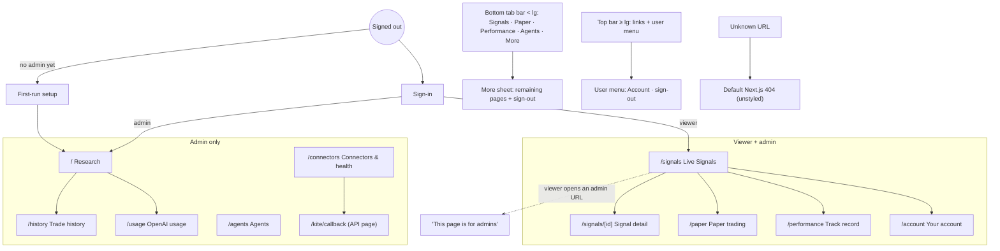

# UI Review: TradingAgents India

**Review details:**
- **Scope:** `ui/` (Next.js 14.2.35 App Router, all client pages, SWR polling, Tailwind, Recharts) at commit `c50cc78`.
- **Date:** 17 Oct 2026.
- **Method:**
  - **Screenshots:** the [`scripts/ui_screens.py`](scripts/ui_screens.py) harness ran Playwright with the installed Edge against a **local demo stack** (UI on `127.0.0.1:3001`, API on `:8000`, SQLite demo database with synthetic signals). It captured 15 screen states at 375, 768 and 1440 px, giving 45 full-page PNGs in [`screenshots/`](screenshots/).
  - **Accessibility:** axe-core 4.10.2 checked WCAG 2.2 AA (tags wcag2a/aa, 21a/aa, 22aa) at 375 and 1440 px.
  - **Page metrics:** CLS, horizontal overflow, target sizes and console errors.
  - **Code:** I also read the component code.

No production system was used.

**How to read the screenshots:** they are full-page captures, so the fixed mobile bottom bar shows up part-way down the image, where the first viewport ended. That is a capture artefact, not a layout bug. All data on screen is synthetic demo data.

---

## 1. Screen inventory (19 = 10 routes + 9 non-route)

| # | Screen | Route / host | Roles | Use cases | Status |
|---|---|---|---|---|---|
| 1 | Research | `/` | admin (viewer redirected to /signals) | UC-11, UC-12 | STUB (dead Export, rows look clickable) |
| 2 | Live Signals | `/signals` | admin, viewer | UC-07 | COMPLETE |
| 3 | Signal detail | `/signals/[id]` | admin, viewer | UC-08 | COMPLETE |
| 4 | Paper trading | `/paper` | admin, viewer (reset: admin) | UC-10 | COMPLETE |
| 5 | Track record | `/performance` | admin, viewer | UC-09 | COMPLETE |
| 6 | Agents | `/agents` | admin | UC-06, UC-20 | COMPLETE |
| 7 | Trade history | `/history` | admin | UC-12 | STUB (dead Export; data ephemeral) |
| 8 | OpenAI usage | `/usage` | admin | UC-13 | PARTIAL (data ephemeral) |
| 9 | Connectors & health | `/connectors` | admin | UC-15–18, UC-21 | COMPLETE |
| 10 | Your account | `/account` | admin, viewer | UC-19 | COMPLETE |
| 11 | Sign-in | AuthGate (any path) | signed out | UC-14 | COMPLETE |
| 12 | First-run setup | AuthGate | signed out, no admin yet | UC-14 | COMPLETE (not captured; needs an empty database) |
| 13 | "This page is for admins" | RouteGuard | viewer | — | COMPLETE |
| 14 | More sheet (mobile drawer) | MobileNav | all | navigation | COMPLETE |
| 15 | User menu (desktop) | Navbar | all | navigation, sign-out | COMPLETE (not captured separately) |
| 16 | Paper reset popover | `/paper` | admin | UC-10 | COMPLETE |
| 17 | Add user / reset password / delete panels | `/account` | admin | UC-19 | COMPLETE |
| 18 | Reconnecting toast | global | all | — | COMPLETE |
| 19 | Kite login result pages | `/kite/callback` (API, HTML) | admin | UC-18 | COMPLETE (server-rendered HTML with inline styles, `api/routes/options.py:L47-L66`) |
| — | **404 / error / loading** | `not-found.tsx`, `error.tsx`, `global-error.tsx`, `loading.tsx` | — | — | **MISSING**: Next.js falls back to its default white pages |

Every one of the 10 `page.tsx` routes is listed (rows 1–10).

## 2. Navigation map

## 3. Per-screen results

Measured values come from `scripts/ui_screens.out.json`.
- **Overflow** means `scrollWidth > innerWidth`; there was none on any screen at any width.
- **Touch < 40 px** counts touch targets under 40 px on touch layouts (375 and 768); it was 0 everywhere.
- **axe** counts violations at 375 + 1440 px.

| Screen | Responsive (375/768/1440) | CLS (375 / 768 / 1440) | axe violations (impact, nodes) | States (loading / empty / error / stale) | Issues |
|---|---|---|---|---|---|
| Research `/` | ✅ no overflow | 0.02 / **0.40** / **0.12** | select-name (critical, 2+2); contrast (105) | ✅ / ✅ / ✅ SSE error / n/a | 5 |
| Live Signals | ✅ | 0 / 0.04 / 0.08 | contrast (103) | ✅ skeleton / ✅ "no signals" / ✅ / ✅ freshness label | 1 |
| Signal detail | ✅ | 0 / **0.15** / 0.09 | contrast (93) | ✅ / n/a / ✅ not-found message / ✅ | 3 |
| Paper trading | ✅ | 0 / **0.10** / 0.02 | aria-prohibited-attr (1+1); contrast (120) | ✅ / ✅ / ✅ / n/a | 3 |
| Track record | ✅ | 0 / 0.01 / 0.01 | aria-prohibited-attr (2+2); contrast (102) | ✅ / ✅ "building history" / ✅ / n/a | 2 |
| Agents | ✅ | 0 / **0.15** / 0.06 | link-in-text-block (1+1); contrast (130) | ✅ / ✅ "waiting for data" / ✅ / ✅ heartbeat age | 3 |
| Trade history | ✅ | 0 / **0.68** / **0.19** | select-name (critical, 1+1); contrast (168) | ✅ / ✅ / ✅ / n/a | 6 |
| OpenAI usage | ✅ | 0 / 0.06 / 0.07 | contrast (35) | ✅ / ✅ / ✅ / n/a | 2 |
| Connectors & health | ✅ | 0 / 0.07 / 0.06 | target-size (2 at 1440); contrast (147) | ✅ / ✅ "not set" / ✅ per check / ✅ "checked N ago" | 3 |
| Your account | ✅ | 0 / 0.05 / 0.03 | contrast (37) | ✅ / ✅ / ✅ / n/a | 1 |
| Sign-in | ✅ | 0 / 0 / 0 | contrast (8) | n/a / n/a / ✅ throttle message / n/a | 1 |
| "For admins" (viewer) | ✅ | 0 / **0.10** / 0.04 | contrast (13) | — | 2 (403 in console, flash) |
| More sheet | ✅ (drawer < 1024 px) | 0 / 0.04 / **0.12** (sheet absent at 1440) | contrast (103, page underneath) | — | 1 |
| 404 (unknown URL) | ✅ | 0 / 0.01 / 0.00 | contrast (8) | — | 2 (unbranded white page; 404 resource logged) |
| Viewer: Live Signals | ✅ | 0 / 0.04 / 0.07 | contrast (102) | as Live Signals | 1 |

**Total axe nodes:** 1,274 colour-contrast, 6 select-name, 6 aria-prohibited-attr, 2 link-in-text-block and 2 target-size.

**Perceived performance (measured earlier on 17 Oct):**
- Shared JS is 87.5 kB.
- Polling is memoised, so an unchanged poll changes 0 DOM nodes.
- A page transition renders on the first frame.
- There's no flicker on polling, because SWR keeps the previous data and signal cards are memoised.

## 4. Findings per screen

### Global (all screens)
- **G-1 (Serious, F-28) Muted text fails contrast.**
  - Secondary text uses the `--muted` token #64748b (`globals.css:L14`, `tailwind.config.js:L16`, used in about 234 places), plus #475569 (57 places).
  - On the #0b0f1a / #111827 / #1a2233 surfaces that is about **3.3–3.7:1** for #64748b and **2.1–2.3:1** for #475569, against AA's 4.5:1.
  - Fix: raise the muted token to #94a3b8 (6.2:1 on #1a2233, 6.9:1 on #111827). Keep the visual hierarchy with size and weight, not low contrast.
  - Evidence: axe `color-contrast` on all 15 screens.
- **G-2 (Low, F-30) No `not-found.tsx` / `error.tsx` / `global-error.tsx` / `loading.tsx`.**
  - An unknown URL shows the bright white default page inside a dark app (`screenshots/not-found-375.png`).
  - A render error shows the default error overlay.
- **G-3 (Medium, F-28) Weak keyboard focus indicator on form controls.**
  - 12 form controls set `outline-none`. Six replace it with `focus:border-…` and three with `focus-within` on the wrapper.
  - The Research exchange `<select>` (`TickerForm.tsx:L44-L47`) and the History status `<select>` (`TradeHistoryTable.tsx:L70-L73`) show no focus indicator (WCAG 2.4.7).
  - Only one control uses a `focus-visible` ring (`AuthGate.tsx:L181`).
  - Buttons and links keep the browser default ring.
  - I didn't audit keyboard order through the More sheet and dialogs. Re-test with keyboard only (R-20).
- **G-4 (Info, a strength) Shared freshness and clock behaviour.**
  - The live IST clock and market-status chip appear on every page.
  - "updated Ns ago" labels and the reconnect toast are consistent.
  - The bottom tab bar is 56 px tall with targets ≥ 44 px.

### Research `/`
- **R-a (Critical a11y, F-28):** two `<select>` controls have no accessible name (axe `select-name`): the NSE/BSE exchange picker (`TickerForm.tsx:L44`) and the embedded history status filter (`TradeHistoryTable.tsx:L70`). Add `<label>` or `aria-label`.
- **R-b (Medium, F-15):** the embedded trade-history table always shows Entry "—" (`entry_price` isn't in `ExecutionResult`) and Exchange "NSE" (the suffix is stripped before the exchange is derived) (`TradeHistoryTable.tsx:L117, L150-L155`).
- **R-c (Low, F-32):** dead **Export** button (`L87-L90`), and rows with `cursor-pointer` but no action (`L159`).
- **R-d (Low, F-29):** CLS 0.40 at 768 px, because the results area grows as streamed agent cards arrive. Reserve a skeleton height per agent card.
- **R-e (Low):** no "cancel run" control; navigating away doesn't stop the server run (F-19).

### Live Signals `/signals`
- **S-a (Info, a strength):** state is clear at a glance: index board, open signals, NO-TRADE reasons, freshness. It adapts from 1 to 3 columns.
- **S-b (Low, G-1):** contrast only.

### Signal detail `/signals/[id]`
- **D-a (Low):** the page has **no `<h1>`** (the contract name is styled text). Screen-reader users get no page title heading. Make the contract line an `<h1>`.
- **D-b (Low, F-29):** CLS 0.15 at 768 px, as the confidence and lifecycle panels load after the header.
- **D-c (Info):** the confidence breakdown explains itself well. It shows points per pillar and states that confidence is "not a promise of winning". Long pillar details are cut off (`…`) at 375 px with no way to expand them. Consider a tap-to-expand.

### Paper trading `/paper`
- **P-a (Serious a11y):** `aria-label` on a plain `
` (axe `aria-prohibited-attr`), on the balance chart wrapper (`PaperChart.tsx:L15`). Use `role="img"` plus `aria-label`, or a visually hidden caption, plus a table alternative.
- **P-b (Low):** CLS 0.10 at 768 px (the chart mounts after the data).
- **P-c (Info):** the reset popover is admin-only, as intended.

### Track record `/performance`
- **T-a (Serious a11y):** the same `aria-prohibited-attr` on both chart wrappers (`PerformanceCharts.tsx:L23, L64`).
- **T-b (Medium, F-13):** no uncertainty is shown: there's no confidence interval or "n more trades needed", so small samples look decisive. The "building history" label helps, but it isn't statistical (R-16).

### Agents `/agents`
- **A-a (Serious a11y):** an inline link inside text is distinguished by colour only (axe `link-in-text-block`; the link only underlines on hover). Underline it always.
- **A-b (Low):** CLS 0.15 at 768 px.
- **A-c (Info):** good per-agent status with last error and timing; the self-test result is shown inline.

### Trade history `/history`
- **H-a (Critical a11y):** unlabeled filter `<select>`.
- **H-b (Medium, F-15):** the same Entry "—" and Exchange "NSE" defects; the data resets on every deploy.
- **H-c (Low, F-32):** dead Export button; rows look clickable but aren't.
- **H-d (Low, F-29):** **CLS 0.68 at 768 px**, the worst measured. The table replaces a short skeleton. Match the skeleton's height to the table.

### OpenAI usage `/usage`
- **U-a (Medium, F-15):** totals reset on every deploy. The page doesn't say that it covers "since the last deploy".

### Connectors & health `/connectors`
- **C-a (Serious a11y):** 2 icon buttons under 24 px at 1440 px (axe `target-size`), the "Show" eye toggle and the "Remove saved value" button inside a secret field (`ConnectorCard.tsx:L42, L48`). Pad them to 24 px.
- **C-b (Low, F-41):** the trading-rules card says changes apply "at the next session start", but only in the card description. Show a clearer note after saving.
- **C-c (Info, a strength):**
  - Health checks show the reason, latency and age.
  - Secrets are shown only as masked 4-character tails.
  - The "Where to get these" links help.
  - The Account card warns when `SECRET_KEY` isn't set.

### Your account `/account`
- **Y-a (Low, G-1):** contrast only. The role-specific panels (users list only for admins) work as intended.

### Sign-in / first-run setup
- **I-a (Info):** clear errors and throttle message; the password field has the right `autocomplete` values.

### "This page is for admins" (viewer)
- **V-a (Low, F-31):** RouteGuard renders the admin page before the role is known, so the page's first API call returns **403** (console error) and content may flash for a frame. Render nothing until `me` resolves (`RouteGuard.tsx:L14-L16`).

### 404
- **N-a (Low, F-30):** the default unstyled white Next.js 404, with no route back. Add a branded `not-found.tsx` with links to Signals and Research.

## 5. Top 10 UI fixes (ordered by user impact ÷ effort)

| # | Fix | Screens | Effort | Roadmap |
|---|---|---|---|---|
| 1 | Raise the muted text token to ≥ 4.5:1 (#94a3b8 on dark surfaces); this fixes most of the 1,274 contrast nodes | all | S | R-20 |
| 2 | Add `aria-label` or `<label>` to every `<select>` (critical) | Research, History | S | R-20 |
| 3 | Fix Entry and Exchange columns; wire Export to CSV or remove it; drop `cursor-pointer` on rows | Research, History | S | R-11 |
| 4 | Branded `not-found.tsx`, `error.tsx`, `global-error.tsx` | all | S | R-13 |
| 5 | RouteGuard waits for the role (no 403, no flash) | admin pages for viewers | S | R-13 |
| 6 | Size skeletons to the real content (History table, Research agent cards, charts) so CLS ≤ 0.1 | History, Research, Detail, Agents, Paper | S | R-21 |
| 7 | Charts: `role="img"` + `aria-label` + a "show as table" toggle | Paper, Track record | S | R-20 |
| 8 | Show uncertainty on Track record: 95% CI band on expectancy, "n more trades needed" | Track record | M | R-16 |
| 9 | Signal-card line: "Place an SL order (trigger ₹X, limit just below) or a GTT at your broker right after entry" (SL-M isn't allowed on NSE options) | Signals, Detail, Telegram | S | R-32 |
| 10 | `<h1>` on Signal detail; always-underlined inline links; 24 px targets for the secret-field buttons; a visible focus style wherever `outline-none` is set | Detail, Agents, Connectors, forms | S | R-20 |

**Also recommended (R-30):** run [`scripts/ui_screens.py`](scripts/ui_screens.py) in CI as a visual-regression and accessibility gate (fail on any critical or serious axe violation, or on CLS > 0.1).
