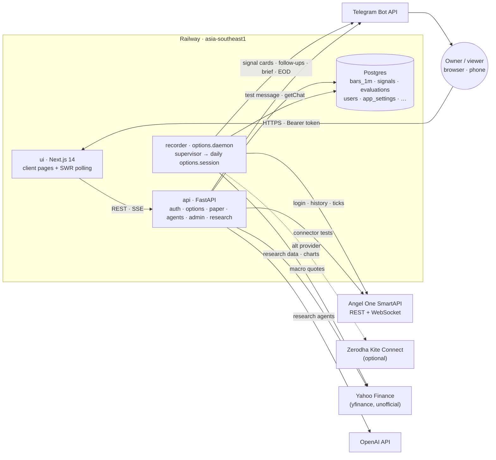
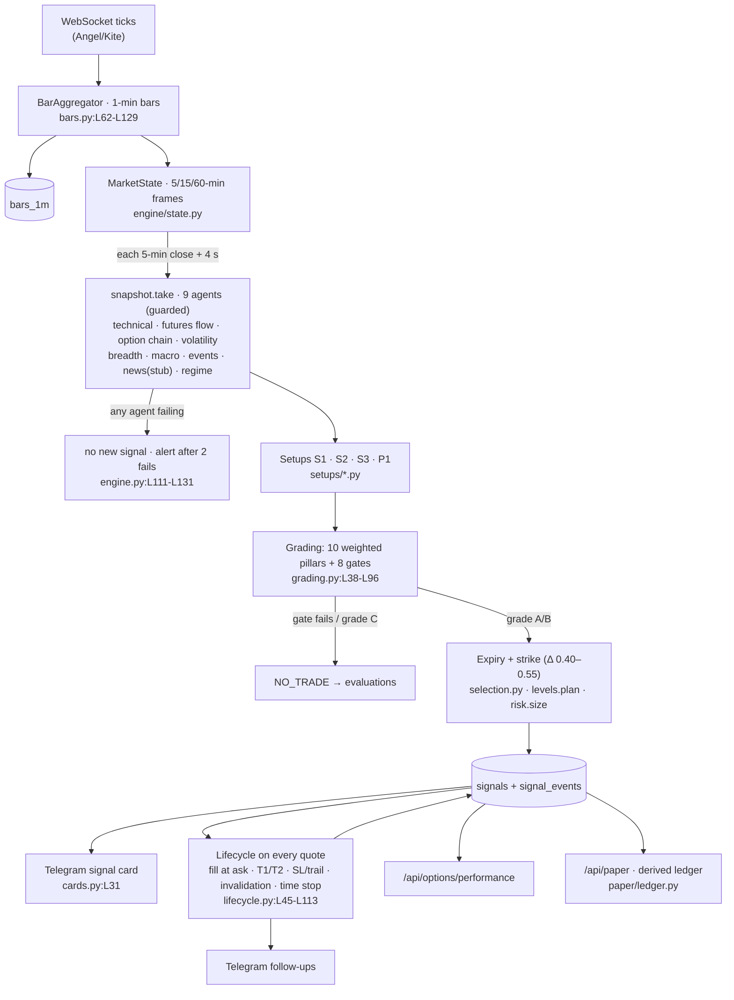

# Review notes (running)

Status: **Phases 1–7 complete (17 Oct 2026); deliverables written:**
- [`PLATFORM_REVIEW.md`](PLATFORM_REVIEW.md)
- [`UI_REVIEW.md`](UI_REVIEW.md)
- [`backlog.csv`](backlog.csv)

The owner accepted the inferred context and the defaults: synthetic data only, and reference tools in a separate venv. §3 below is the raw pre-verification list. The verified findings are in PLATFORM_REVIEW §7.
Commit reviewed: `c50cc78` on `feature/options-signal-tool`. Working tree clean apart from `docs/review/`.
Nothing in the source was modified. No live system, broker, LLM or production database was touched.

---

## 0. Project context (all INFERRED unless the owner confirms)

| Field | Value | Source |
|---|---|---|
| Platform and purpose | INFERRED: a personal **NIFTY index-options signal tool** (buy-only CE/PE alerts that are tracked to their result), next to an older **multi-agent LLM stock-research pipeline** | `docs/index-options-plan.md` §0; `docs/build-progress.md`; `README` absent |
| Users | INFERRED: the owner (admin). An optional **viewer** role exists. The plan says to keep signals personal (SEBI RA registration is needed to share them) | `options/admin/repo.py:L24` (ROLES); `docs/index-options-plan.md:L593-L598` |
| Markets and instruments | INFERRED: NSE **NIFTY weekly and monthly options** (BANKNIFTY/FINNIFTY planned); NIFTY near-month futures, India VIX and 13 NIFTY heavyweights as inputs. Research: NSE/BSE equities via Yahoo | `options/config.py:L40`; `options/core/constituents.py:L1-L20` |
| Style and timeframes | INFERRED: **intraday** (decisions on 5-min closes built from recorded 1-min bars, entries 09:30–15:00, square-off 15:15) and **positional** (daily trend P1) | `options/engine/engine.py:L100-L109`; `options/engine/lifecycle.py:L15` |
| Mode | INFERRED: **alerts + automatic paper tracking** (SHADOW/LIVE labels). **No order placement exists anywhere** (`git grep` for place/modify/cancel order and GTT finds nothing) | `agents/execution.py:L1-L31` ("SIMULATED") |
| Brokers and data | INFERRED: Angel One SmartAPI (default, data only), Zerodha Kite Connect (optional), Yahoo Finance via yfinance (unofficial), OpenAI (research LLMs), Telegram (alerts) | `options/config.py:L11-L30`; `config/settings.py:L7-L8` |
| Targets | INFERRED from the plan: positive expectancy after costs per setup; ≥ 50 shadow signals over 4–6 weeks before LIVE; auto-demote a setup when its rolling 30-signal expectancy ≤ 0; 3% risk per trade, 10% daily stop, ₹1,00,000 capital; NO TRADE on stale data (> 180 s). **No numeric drawdown, Sharpe or latency target is stated** | `docs/index-options-plan.md:L180, L566-L571`; `options/engine/grading.py:L23` |
| PRD | INFERRED: `docs/index-options-plan.md` (plan v2) | |
| Design system | INFERRED: Tailwind tokens (bg #0b0f1a, surface #111827, card #1a2233, border #1e2d45, accent #ff9933) | `ui/tailwind.config.js:L7-L17`, `ui/src/app/globals.css:L5-L16` |
| Out of scope | INFERRED: automated order placement (decision: buy-only signals traded by hand); WhatsApp (later) | `docs/index-options-plan.md` §0, Appendix B |

---

## 1. Phase 1: Reconnaissance

### 1.1 Structure, sizes and entry points

| Area | Files | Lines | Role |
|---|---|---|---|
| `options/` | 65 | 6,467 | Signal tool: brokers, recorder, 9 analysis agents, setups, engine, paper ledger, admin, backtest |
| `api/` | 13 | 1,251 | FastAPI app and routes |
| `agents/`, `orchestrator/`, `models/`, `utils/`, `config/` | 28 | 1,929 | Research pipeline (13 LLM agents) and shared utils |
| `ui/src` | 63 | 7,042 | Next.js 14 dashboard |
| `tests/` | 31 | 3,603 | pytest (255 tests) |

Entry points:
- `uvicorn api.main:app` (`Dockerfile` CMD; `api/main.py:L1-L82`)
- `python -m options.daemon` when `SERVICE_ROLE=recorder` (`Dockerfile` CMD; `options/daemon.py:L150-L168`), which spawns `python -m options.session` daily (`options/daemon.py:L49-L51`; `options/session.py:L263-L277`)
- `python -m options.backtest.replay` (CLI; `options/backtest/replay.py:L109-L130`)
- `python main.py analyze TICKER` (research CLI; `main.py:L131-L174`)
- `next start` (UI; `ui/Dockerfile`)

### 1.2 Frameworks and versions (installed)

**Backend:**
- Python 3.12
- FastAPI 0.143.2, Starlette 1.8.0, Uvicorn 0.54.0
- Pydantic 2.14.1, pydantic-settings 2.16.0
- SQLAlchemy 2.1.4, psycopg 3.3.6
- pandas 3.0.6, numpy 2.5.4
- openai 3.31.0, yfinance 1.7.0, kiteconnect 5.2.2, smartapi-python 1.5.5, pyotp 2.10.0
- cryptography 50.0.2, tenacity 9.2.1, pytest 9.1.1

**UI:**
- Next 14.2.35 (App Router), React 18.3.1, TypeScript 5.9.3
- SWR 2.5.1, Recharts 2.15.4, Tailwind 3.4.19, lucide-react 0.378.0, date-fns 3.6.0

**Version pinning:** `requirements.txt` has floor pins only (`>=`), no lock file, so builds are not reproducible.

### 1.3 Configuration and environment variables

Each setting below is listed with its default. Values saved on the Connectors page override the environment (`options/admin/connectors.py:L83-L94`).

- **Signal tool** (`options/config.py`):
  - **Data provider:** `DATA_PROVIDER` = angel (L11)
  - **Angel One:** `ANGEL_API_KEY`, `ANGEL_CLIENT_CODE`, `ANGEL_PIN`, `ANGEL_TOTP_SECRET`, `ANGEL_HISTORICAL_API_KEY` (L15-L20)
  - **Kite:** `KITE_API_KEY`, `KITE_API_SECRET`, `KITE_USER_ID` (L24-L26)
  - **Telegram:** `TELEGRAM_BOT_TOKEN`, `TELEGRAM_CHAT_ID` (L29-L30)
  - **Access and storage:** `DASHBOARD_TOKEN` (legacy static API token, L34), `DATABASE_URL` = sqlite:///data/options.db (L37)
  - **Trading rules:** `OPTIONS_INDICES` = ["NIFTY"], `OPTIONS_CAPITAL` = 100000, `OPTIONS_RISK_PER_TRADE_PCT` = 3, `OPTIONS_DAILY_LOSS_STOP_PCT` = 10, `OPTIONS_LIVE_SETUPS` = [] (L40-L46)
  - **Pricing and recording:** `OPTIONS_RISK_FREE_RATE` = 0.06, `OPTIONS_STRIKE_WINDOW` = 15, `OPTIONS_EXPIRIES_TRACKED` = 2, `OPTIONS_STALE_AFTER_S` = 60 (L47-L52)
- **Research** (`config/settings.py`):
  - **OpenAI:** `OPENAI_API_KEY`, `MODEL_NAME` = gpt-4, `LLM_TEMPERATURE` = 0.3, `LLM_MAX_RETRIES` = 3 (L7-L10)
  - **Price overrides:** `OPENAI_PRICE_*` (L12-L13)
  - **Runtime and paths:** `MAX_PARALLEL_WORKERS` = 4, `LOG_LEVEL`, `LOG_DIR` = logs, `TRADE_LOG_FILE` = logs/trades.jsonl, `DATA_DIR` = data (L14-L18)
- **Process environment:**
  - `ALLOWED_ORIGINS` (`api/main.py:L52`)
  - `SECRET_KEY` (`options/admin/repo.py:L36`)
  - `ADMIN_SETUP_CODE` (`options/admin/repo.py:L220`)
  - `SERVICE_ROLE` (`Dockerfile`)
  - `PORT`
- **UI:**
  - `NEXT_PUBLIC_API_URL` (`ui/src/lib/utils.ts:L5`)
  - `NEXT_PUBLIC_USD_INR` (`ui/src/lib/utils.ts:L45`)
  - `API_BASE_URL` (`ui/next.config.mjs:L10`)

**Secrets:**
- **Tracked files:** no real secrets in tracked files or git history. The only matches are fake test fixtures (`tests/options/test_admin.py:L25-L26, L189, L283`; values redacted).
- **Local `.env`:** a local `.env` exists and is git-ignored (`.gitignore:L14`) and docker-ignored (`.dockerignore:L4`). It was not opened.
- **Earlier exposure:** in an earlier session, a Railway CLI command printed the `OPENAI_API_KEY` value into a tool transcript. The location is the Railway variables of the `api` service. Rotating that key is recommended. UNVERIFIED whether it has been rotated.

### 1.4 Database schema (`options/storage.py`)

| Table | Key / indexes | Purpose | Readers |
|---|---|---|---|
| `kite_sessions` (L21) | id; trading_date idx | Daily broker session marker/token (Kite token; "auto-login" marker for Angel) | session, status, health |
| `instruments_daily` (L30) | (trading_date, token) | Daily instrument dump | session, replay |
| `bars_1m` (L44) | (instrument_token, ts) | 1-min OHLC + volume_day, OI, bid/ask, qty, ticks | engine, replay, paper (latest bid), status |
| `session_events` (L61) | id | Connect/disconnect/error log | **write-only: no reader anywhere** |
| `signals` (L69) | signal_id; created_at idx; state idx | Signal records (JSON payload) | engine, API, paper |
| `signal_events` (L83) | id; signal_id idx | Lifecycle events | API detail |
| `evaluations` (L94) | id; ts idx | Every trigger and its outcome (NO_TRADE reasons) | API decision log |
| `board_state` (L108) | index_name | Latest analysis board | API board |
| `agent_status` (L117) | key | Agent health per index, research, self-test | API agents |
| `users` (L126) | id; username unique | Accounts (PBKDF2 hash, role, full_name, disabled) | auth |
| `user_sessions` (L138) | token_digest; user_id idx | Session tokens (SHA-256 digests) | auth |
| `app_settings` (L147) | key | UI-managed settings (secrets Fernet-encrypted) | config |
| `app_meta` (L156) | key | Key/value (recorder status/command, paper account, setup code digest, generated key) | daemon, API |
| `health_checks` (L163) | check_id | Latest health results | API |

**Observations for later phases:**
- Prices and P&L are stored and computed as `Float` (`L48-L54`, Signal pydantic floats).
- `max(ts)` (`last_bar_ts`, L297) and `count_bars_since` (L285) filter on `ts` without a usable index, because `ts` is the second column of the primary key. That means full scans of a table growing at about 50k rows a day (INFERRED: about 140 tokens × 375 min). Both run on `/api/options/status`, which every page polls.
- Migrations: `create_all` plus the hand-written `_add_missing_columns` (L198-L215). There is no migration tool and no version table.

### 1.5 Market-data pipeline

1. **Scheduling:** the daemon calls `next_start` at 08:30 IST on trading days (`options/daemon.py:L38-L56`) and spawns `options.session`.
2. **Login:** Angel One logs in automatically with MPIN and TOTP, retrying with backoff (`options/session.py:L44-L66`). Kite needs a manual daily login link (`L69-L93`).
3. **Instruments and reference:** the instrument dump is saved, and the index reference (expiries, strikes, lot) is built (`options/reference.py`; `options/session.py:L111-L160`).
4. **Warm-up history:** historical minute bars are loaded, throttled to about 3 requests a second on Angel (`options/brokers/angel.py:L295-L319`; `options/session.py:L215-L247`). VIX daily history is loaded too, and macro data comes from yfinance (`options/agents/macro.py:L36-L40`).
5. **Live ticks:** Angel SmartWebSocketV2 runs in a thread with a reconnect loop (300 tries, 60 s maximum delay; `options/brokers/angel.py:L327-L433`). Kite uses KiteTicker with reconnect (`options/brokers/kite.py:L61-L96`).
6. **Candle building:** ticks become 1-min bars (`options/market_data/bars.py:L62-L129`), closed after a 3 s grace period (`L112-L119`).
7. **Persistence:** the recorder flushes bars to `bars_1m`, retrying failed writes (`options/market_data/recorder.py:L111-L130`). It raises a stale alert after 60 s without ticks (`L151-L164`) and re-centres the strike window (`L98-L108`).
8. **Engine:** the engine resamples to 5/15/60 min aligned to 09:15 (`options/engine/state.py`) and evaluates on each 5-min close (`options/engine/engine.py:L100-L109`).

### 1.6 Schedulers and jobs

| Job | Where | When |
|---|---|---|
| Recorder supervisor (always on) | `options/daemon.py:L57-L148` | Polls every 15 s; starts the session at 08:30 IST on trading days, or late before 15:00 |
| Daily session | `options/session.py:L111-L212` | 08:30 → recording until `RECORD_UNTIL` |
| Signal evaluation | `options/engine/engine.py:L100-L109` | Each 5-min bucket close + 4 s delay (EVAL_DELAY_S) |
| Morning brief / EOD | `options/engine/engine.py:L294-L340` | Session start / close |
| UI polling (SWR) | `ui/src/app/signals/page.tsx:L16-L19` | Signals 5 s, board 15 s, status 30 s, evaluations 30 s |

### 1.7 Broker integration

**Data only:**
- Angel: login, instruments, index prices, previous closes, historical candles, websocket (`options/brokers/angel.py:L186-L325`).
- Kite: the same plus `login_url` and `create_session` (`options/brokers/kite.py:L12-L58`).

**No orders:**
- **Order calls:** no order, GTT, positions or holdings call exists.
- **Research "execution":** it writes a simulated record to `logs/trades.jsonl` (`agents/execution.py:L22-L63`).

### 1.8 LLM agents (research pipeline)

- **Pipeline:** six stages and 13 agents (`orchestrator/pipeline.py:L37-L249`). Stage 1 runs 4 analysts in parallel threads (L155) and stage 4 runs 3 risk agents in parallel (L218).
- **Client:** `utils/llm.py:L26-L80`.
  - Model `settings.MODEL_NAME` (default `gpt-4`; production overrides it to gpt-4o-mini via the Connectors page, INFERRED from earlier health output).
  - Temperature 0.3.
  - JSON mode for known models (L37-L49); tenacity retries (L51).
- **Output validation:** pydantic validation with one feedback retry (`agents/base.py:L34-L75`).
- **Inputs:**
  - **Market data:** yfinance 3-month daily history plus computed indicators (`agents/market_data.py:L63-L112`).
  - **Fundamentals:** yfinance `info` (`agents/fundamentals.py:L18-L19`).
  - **News:** yfinance news, top 15 (`agents/news.py:L16-L21`).
  - **Sentiment:** yfinance headlines **plus "your knowledge of current market sentiment"** (`agents/sentiment.py:L33-L57`, the memory instruction at L43). That is model memory, with a hallucination and leakage risk.

### 1.9 Frontend

- **Framework:** Next.js App Router. All pages are client components (`"use client"`).
- **Data:** SWR polling (`ui/src/lib/optionsApi.ts`, `ui/src/components/layout/DataProvider.tsx`). The research pipeline uses SSE (`ui/src/hooks/usePipelineStream.ts:L39`).
- **Auth:**
  - **Token:** a Bearer session token kept in `localStorage` (`ui/src/lib/optionsApi.ts:L6, L27-L49`).
  - **Route guard:** in the client (`ui/src/components/layout/RouteGuard.tsx`). The API enforces the same rules (`api/main.py:L66-L78`).
- **Charts:** Recharts (`ui/src/components/options/PerformanceCharts.tsx`, `PaperChart.tsx`, `ui/src/components/charts/*`).
- **Real time:** polling only; no websocket to the browser.
- **Build config:** `typescript.ignoreBuildErrors: true` and `eslint.ignoreDuringBuilds: true` (`ui/next.config.mjs:L3-L8`). There is no ESLint config, so `next lint` is interactive.

### 1.10 Tests, CI/CD, deployment and docs

- **Tests:**
  - pytest: **255 passed** in 82 s (run on 17 Oct 2026, local, no network).
  - **Coverage is not configured** (no pytest-cov, no `.coveragerc`).
  - **UI tests: 0** (no component, end-to-end or visual tests).
  - `tsc --noEmit` passes.
- **Dependency audit:** `npm audit --omit=dev` reports **2 production advisories**:
  - **next 14.2.35, critical:** Image Optimizer remotePatterns DoS and RSC deserialization DoS. Fixed only in next ≥ 16.4.2.
  - **postcss, high:** XSS in stringify; sourceMappingURL file read.
  - Applicability is still to be assessed in Phase 5.
  - The Python dependency audit was not run, because pip-audit isn't installed (UNVERIFIED).
- **CI/CD: none.** There is no `.github/` and no pipeline.
- **Deployment:**
  - Manual `railway up` from the local tree into 4 Railway services in `asia-southeast1` (api, ui, Postgres, recorder).
  - Root `railway.json` uses the Dockerfile builder with healthcheck `/health`.
  - `ui/railway.json` uses healthcheck `/`.
  - Railway deprecates config-as-code on 2026-12-01 (`docs/options-runbook.md` §8).
- **Docs:** `docs/index-options-plan.md` (plan), `docs/options-runbook.md` (operations), `docs/build-progress.md` (status). There is no README at the root.

### 1.11 Architecture

### 1.12 Data → signal → "order" flow

There is no broker order. The terminal step is a Telegram alert plus paper tracking.

---

## 2. Phase 2: Inventories

### 2.1 Use cases (31)

Status counts:
- **COMPLETE 20**
- **PARTIAL 3**
- **STUB 1**
- **PLANNED 7**
- **BROKEN 0**
- **ORPHANED 0** (one orphaned UI label, "KILL", is listed under UC-26)

Core: 15 · Supporting: 16.

**Statuses are code-traced; production behaviour is not observed.** The recorder has not yet run a live session; the first is Mon 19 Oct 2026 08:30. So every live-data path is "COMPLETE in code, UNVERIFIED in production" until that session is recorded.

| ID | Use case | Actor | Core/Sup | UI screen | API endpoint(s) | Logic / agent | Data / tables | External | Tests | Status |
|---|---|---|---|---|---|---|---|---|---|---|
| UC-01 | Start the trading-day session at 08:30 IST: broker login, instruments, warm-up history, morning brief | System | Core | Connectors › Recorder card; Signals status chips | `/api/options/status`, `/api/admin/health` | `options/daemon.py:L38-L148`; `options/session.py:L44-L212` | kite_sessions, instruments_daily, bars_1m, app_meta | Angel/Kite, Telegram, Yahoo (macro) | test_daemon, test_session, test_angel | COMPLETE |
| UC-02 | Record live market data: ticks → 1-min bars → DB, with reconnects and stale alerts | System | Core | Signals "Market data Xs ago"; Connectors "Market data feed" | status, health | `bars.py:L62-L129`; `recorder.py:L30-L192`; `angel.py:L327-L433` | bars_1m, session_events | Angel/Kite WS, Telegram | test_bars, test_recorder, test_angel | COMPLETE |
| UC-03 | Generate graded signals on each 5-min close and alert on Telegram | System | Core | /signals (open signals, decision log) | `/api/options/signals`, `/evaluations`, `/board` | `engine.py:L100-L275`; `snapshot.py`; `grading.py:L38-L96`; `setups/*`; `selection.py:L9-L40`; `risk.py:L34-L58`; `cards.py:L31-L54` | signals, signal_events, evaluations, board_state, agent_status | Telegram | test_setups_engine, test_engine_parts, test_agents, test_phase_f | COMPLETE |
| UC-04 | Track each signal to its result and send follow-ups | System | Core | SignalCard price track; /signals/[id] lifecycle | `/api/options/signals/{id}` | `lifecycle.py:L29-L113`; `engine.py:L146-L171, L277-L292` | signals, signal_events | Telegram | test_engine_parts, test_setups_engine | COMPLETE (tracked only in-process; no broker-side stop, and none needed since nothing is placed) |
| UC-05 | Morning brief and end-of-day report | System | Supporting | (Telegram only) | — | `engine.py:L294-L340`; `cards.py:L62-L90` | signals | Telegram | test_setups_engine, test_session | COMPLETE |
| UC-06 | Watch agent health, pause new signals while an agent fails, alert | System | Supporting | /agents | `/api/agents` | `options/agents/health.py`; `snapshot.py:L58-L106`; `engine.py:L111-L131` | agent_status | Telegram | test_phase_f | COMPLETE |
| UC-07 | Monitor the live dashboard: market status, board, open signals, decision log, clock | User | Core | /signals; navbar clock | status, board, signals, evaluations, `/api/time` | `api/routes/options.py:L92-L218` | bars_1m, board_state, signals, evaluations | — | test_routes, test_phase_f | COMPLETE |
| UC-08 | Inspect one signal: analysis, confidence breakdown, lifecycle | User | Core | /signals/[id] | `/api/options/signals/{id}` | `options/engine/confidence.py`; `api/routes/options.py:L180-L188` | signals, signal_events | — | test_phase_f | COMPLETE |
| UC-09 | Review the track record (by setup/grade/mode/horizon, equity, R distribution) | User | Core | /performance | `/api/options/performance` | `options/engine/performance.py`; `api/routes/options.py:L190-L213` | signals | — | test_engine_parts, test_routes | COMPLETE |
| UC-10 | Follow signals in a paper account (balance, open MTM, closed trades, daily stop, reset) | User / Admin | Core | /paper | `/api/paper`, `PUT /api/admin/paper` | `options/paper/ledger.py`; `api/routes/paper.py` | signals, bars_1m, app_meta | — | test_phase_f | COMPLETE |
| UC-11 | Research a stock with the 13-agent LLM pipeline (live progress, chart, result) | Admin | Supporting | / (Research) | `POST /api/analyze` (SSE), `/api/pricehistory/{t}` | `orchestrator/pipeline.py`; `api/streaming_pipeline.py`; `agents/*` | logs/trades.jsonl | OpenAI, Yahoo | test_pipeline, test_streaming, test_agents (mocked) | COMPLETE (live run UNVERIFIED: it costs money) |
| UC-12 | Browse research trade history | Admin | Supporting | /history; table on / | `/api/history` | `api/routes/history.py:L12-L40` | **logs/trades.jsonl on the container filesystem: wiped by every redeploy** | — | — | PARTIAL (history is lost on deploy; the Export button is dead) |
| UC-13 | Monitor OpenAI usage and cost | Admin | Supporting | /usage | `/api/usage` | `api/routes/usage.py:L14-L120` | logs/trades.jsonl (same problem) | — | test_usage | PARTIAL (same ephemeral data) |
| UC-14 | First-run admin setup, sign-in/out, sessions | Admin / User | Core | Setup and sign-in screens (AuthGate) | `/api/auth/*` | `api/routes/admin.py:L76-L158`; `options/admin/security.py`, `repo.py` | users, user_sessions, app_meta | — | test_admin, test_users | COMPLETE |
| UC-15 | Manage connector keys: format checks, live test, encrypted storage | Admin | Core | /connectors | `/api/admin/connectors[/{id}]` | `options/admin/connectors.py`, `validation.py`, `health.py` | app_settings, health_checks | Angel, Kite, Telegram, OpenAI (tests) | test_admin | COMPLETE |
| UC-16 | Run system health checks (8 checks) | Admin | Supporting | /connectors (health tiles) | `/api/admin/health`, `/health/run` | `options/admin/health.py` | health_checks | same as UC-15 + Yahoo | test_admin | COMPLETE |
| UC-17 | Set trading rules (capital, risk %, daily stop) and SHADOW/LIVE per setup | Admin | Core | /connectors › Trading card | `PUT /api/admin/trading` | `connectors.save_trading` | app_settings | — | test_admin | COMPLETE (takes effect at the next session start, not live) |
| UC-18 | Switch the data provider (Angel/Kite); daily Kite login | Admin | Supporting | /connectors; Signals "Log in" chip | `PUT /api/admin/data-provider`, `/kite/login`, `/kite/callback` | `api/routes/options.py:L61-L90`; `options/session.py:L69-L93` | app_settings, kite_sessions | Kite | test_routes, test_session | COMPLETE (Kite path UNVERIFIED live) |
| UC-19 | Manage users and roles; own profile and password | Admin / User | Supporting | /account | `/api/admin/users*`, `/api/auth/profile`, `/api/auth/password` | `api/routes/admin.py:L123-L229`; `repo.py` | users, user_sessions | — | test_users, test_access | COMPLETE |
| UC-20 | Run the agent self-test | Admin | Supporting | /agents | `POST /api/admin/agents/selftest` | `options/agents/selftest.py` | agent_status | — | test_phase_f | COMPLETE |
| UC-21 | Restart today's recorder session from the UI | Admin | Supporting | /connectors › Recorder card | `POST /api/admin/recorder/restart` | `options/daemon.py:L113-L126` | app_meta | — | test_daemon, test_admin | COMPLETE |
| UC-22 | Replay recorded sessions through the live engine (backtest) | Developer | Core | — (CLI only) | — | `options/backtest/replay.py:L44-L106` | bars_1m, instruments_daily → separate DB | — | test_replay | PARTIAL (only replays days the recorder captured, and **none exist yet**; no IV-repriced history, no benchmark, Sharpe or walk-forward, no UI) |
| UC-23 | Research CLI (`main.py analyze`) | Developer | Supporting | — | — | `main.py:L131-L174` → pipeline | logs/ | OpenAI, Yahoo | test_pipeline | COMPLETE |
| UC-24 | Auto-demote a setup to SHADOW when its rolling 30-signal expectancy ≤ 0 | System | Core | — | — | — | — | — | — | PLANNED (`docs/index-options-plan.md:L180, L571`) |
| UC-25 | Historical backtest (2+ years of futures 1-min, IV-repriced options) and walk-forward tuning | Developer | Core | — | — | — | — | — | — | PLANNED (`plan:L566-L571, L586`) |
| UC-26 | Kill switch: halt signals and exit open ones on demand | Admin | Core | — (only a "KILL" icon label exists, `cards.py:L17`) | — | `lifecycle.exit_now` supports a reason, but nothing triggers KILL | — | — | — | PLANNED (orphaned label) |
| UC-27 | More setups S4–S7 (range rejection, gap, expiry-day S6, rich-IV range sell) | System | Supporting | — | — | — | — | — | — | PLANNED (`plan:L160-L163`) |
| UC-28 | Ingest news and announcements into the news pillar | System | Supporting | Board "News" tile shows "No news feed connected" | — | `options/agents/events.py:L47-L48` is hardcoded n/a | — | — | — | STUB |
| UC-29 | BANKNIFTY / FINNIFTY signals | System | Supporting | — | — | Index list configurable (`config.py:L40`), but only NIFTY constituents exist | — | — | — | PLANNED |
| UC-30 | WhatsApp alerts | System | Supporting | — | — | — | — | — | — | PLANNED (plan Appendix B) |
| UC-31 | Shock detector (sudden move → NO TRADE) | System | Supporting | — | — | — | — | — | — | PLANNED (`plan` §14 risk table) |

**Plan coverage (INFERRED intended set = plan):**
- **Setups:** 4 of 9 planned implemented: S1, S2, S3, P1 of S1–S7, P1, P2.
- **Build plan:** 8 of 10 weeks delivered in full. Week 5 is partial (no news feed). Week 9 is partial (replay only, no backtest report or walk-forward).

### 2.2 Screens (19: 10 routes + 9 non-route)

| # | Screen | Route | Roles | Use cases | Status |
|---|---|---|---|---|---|
| 1 | Research | `/` (`ui/src/app/page.tsx`) | admin (viewers redirected to /signals) | UC-11, UC-12 | **STUB** by the definition: the embedded trade-history table has a dead **Export** button (`ui/src/components/history/TradeHistoryTable.tsx:L87-L90`, no onClick), and its rows show `cursor-pointer` with no action (L159). Otherwise functional |
| 2 | Live Signals | `/signals` | admin, viewer | UC-07 | COMPLETE |
| 3 | Signal detail | `/signals/[id]` | admin, viewer | UC-08 | COMPLETE |
| 4 | Paper trading | `/paper` | admin, viewer (reset: admin) | UC-10 | COMPLETE |
| 5 | Track record | `/performance` | admin, viewer | UC-09 | COMPLETE |
| 6 | Agents | `/agents` | admin | UC-06, UC-20 | COMPLETE |
| 7 | Trade history | `/history` | admin | UC-12 | **STUB** (same dead Export button); data ephemeral |
| 8 | OpenAI usage | `/usage` | admin | UC-13 | PARTIAL (data ephemeral) |
| 9 | Connectors & health | `/connectors` | admin | UC-15–UC-18, UC-21 | COMPLETE |
| 10 | Your account | `/account` | admin, viewer (users: admin) | UC-19 | COMPLETE |
| 11 | Sign-in | (AuthGate, any path) | signed out | UC-14 | COMPLETE |
| 12 | First-run setup | (AuthGate) | signed out, no admin | UC-14 | COMPLETE |
| 13 | "This page is for admins" | (RouteGuard) | viewer | — | COMPLETE |
| 14 | More sheet (mobile drawer) | (MobileNav dialog) | all | navigation, sign-out | COMPLETE |
| 15 | User menu (desktop dropdown) | (Navbar) | all | navigation, sign-out | COMPLETE |
| 16 | Paper reset form (inline popover) | /paper | admin | UC-10 | COMPLETE |
| 17 | Add user / reset password / delete confirmation (inline panels) | /account | admin | UC-19 | COMPLETE |
| 18 | Reconnecting notice (toast) | global | all | — | COMPLETE |
| 19 | Kite login result pages (server-rendered HTML) | `/kite/callback` | admin | UC-18 | COMPLETE |

**Framework files:**
- `app/layout.tsx` (shell), `app/template.tsx` (page transition) and `app/manifest.ts` (installable app) exist.
- **Missing:** `not-found.tsx`, `error.tsx`, `global-error.tsx` and `loading.tsx`, so Next.js shows its unstyled default 404 and error screens. The route-to-screen map is complete: 10 of 10 `page.tsx` files are listed.

### 2.3 Indicators (signal engine: 31 · research: 11)

Abbreviation: FUT = NIFTY near-month future.

"Checked against reference?":
- **Property:** a unit test checks a definition or property.
- **Math:** Black-76 tests use put-call parity, an IV round trip and finite-difference Greeks.
- **None:** no reference-library (TA-Lib) comparison has been made for anything yet; that comes in Phase 4A.

| # | Indicator | Where computed | Parameters | Timeframe | Used by | Also in UI? | Checked against reference? |
|---|---|---|---|---|---|---|---|
| 1 | EMA 20 / EMA 50 | `quant/indicators.py:L13-L15`; `agents/technical.py:L46` | 20, 50 | FUT 15m and 60m | Trend pillar (votes) → grading, regime, setups (htf_trend) | no | Property (recursive definition) |
| 2 | Supertrend | `indicators.py:L57-L82`; `technical.py:L47` | 10, ×3 | FUT 15m and 60m | Trend pillar votes | no | Property (flips with trend) |
| 3 | RSI (Wilder) | `indicators.py:L21-L27`; `technical.py:L77` | 14; bands 55/45 | FUT 5m | Momentum pillar | no | Property (extremes and range) |
| 4 | MACD histogram | `indicators.py:L29-L33`; `technical.py:L78` | 12/26/9 | FUT 5m | Momentum pillar | no | Property |
| 5 | ADX | `indicators.py:L45-L55`; `technical.py:L79` | 14; trending if > 20 | FUT 15m | Regime classification; momentum strength | no | Property |
| 6 | ATR | `indicators.py:L41-L43`; `technical.py:L134` | 14 | FUT 5m; daily (positional) | Room check (levels pillar), setups, stops | no | Property (constant range) |
| 7 | Session VWAP | `indicators.py:L84-L91`; `technical.py:L92` | daily reset | FUT 5m | S1 pullback level; levels ladder | no | Hand-computed values |
| 8 | Bollinger width (vs 120-bar median) | `indicators.py:L93-L98`; `technical.py:L96` | 20, 2σ | FUT 15m | Regime (squeeze / range) | no | none |
| 9 | CPR, pivots, PDH/PDL/PDC, R1/S1 | `indicators.py:L110-L117`; `technical.py:L99-L103`; `engine.py` (brief) | previous day | daily | Levels ladder; morning brief | no | Hand-computed values |
| 10 | Swing levels (fractals) | `indicators.py:L119-L143`; `technical.py:L108-L113` | k=2, merge 0.1%, within 1.5% | FUT 15m, last 75 bars | Levels ladder; room | no | Hand-computed values |
| 11 | Opening range | `indicators.py:L145-L152`; `technical.py:L104` | first 15 min | FUT 1m | S2 ORB; levels | no | Property |
| 12 | Volume ratio | `technical.py:L95` | last bar ÷ 20-bar mean | FUT 5m | S2 volume confirmation | no | none |
| 13 | Futures price Δ% and OI Δ% → long/short buildup or cover/unwind | `agents/futures_flow.py:L20-L60` | 15-min window | FUT 1m | Futures-flow pillar (weight 15); open-trade flow warning | no | Unit tests (classification) |
| 14 | Basis vs fair basis | `futures_flow.py` | r = 6% | spot/FUT | Detail text | no | none |
| 15 | Option chain: OI walls (max call/put OI) | `agents/option_chain.py:L79-L85` | ±15 strikes | options 1m | S3 OI-wall break; levels | no | Unit tests |
| 16 | PCR (OI) near ATM ± expected move | `option_chain.py:L97-L146` | band 5–15 strikes | options | Option-chain pillar detail/features | no | Unit tests |
| 17 | OI writing change (put vs call writing) | `option_chain.py` | 15-min | options | Option-chain pillar bias | no | Unit tests |
| 18 | Max pain | `option_chain.py:L86-L95` | — | options | **Display text only** | no | none |
| 19 | ATM implied vol (Black-76 on a synthetic forward) | `quant/black76.py:L38-L97`; `agents/volatility.py:L48-L106` | r = 6% | options | Volatility pillar; expected move; premium-rich gate | no | Math (parity, IV round trip) |
| 20 | Greeks (delta, gamma, vega, theta) | `black76.py:L56-L66` | — | options | Strike selection Δ 0.40–0.55 (`selection.py:L9`); theta decay check | no | Math (finite differences) |
| 21 | India VIX level, Δ%, 1-year percentile | `volatility.py:L35-L40, L68-L106` | 252 daily closes; percentile needs ≥ 50 | daily / 1m | Volatility pillar; board | no | none |
| 22 | Realised vol rv20 | `volatility.py:L41-L46` | 20 | daily | Volatility pillar (IV vs RV richness) | no | none |
| 23 | Expected move (1 day, 1σ) | `black76.py:L99-L102` | ATM IV | — | Option-chain band; board | no | Math |
| 24 | Option quality: spread %, depth, theta over the hold | `volatility.py:L116-L150` | warn/fail thresholds (intraday 2%/4%, positional 8%/12% per day) | options | Liquidity gate (option_quality) | no | Unit tests |
| 25 | Breadth: weighted day % and 15-min %, advance/decline of 13 heavyweights | `agents/breadth.py:L7-L45` | approximate weights (`core/constituents.py`) | equities 1m | Breadth pillar (weight 10) | no | Unit tests |
| 26 | Macro risk score (Nikkei, Hang Seng, US futures, US 10Y, …) | `agents/macro.py:L20-L95` | daily changes, signed | daily (Yahoo) | Macro pillar (weight 5) | no | Unit tests |
| 27 | Event windows (RBI, FOMC, Budget, expiry) | `agents/events.py:L16-L45`; `core/events.py:L31-L35` | hardcoded calendar (5 events) | — | Events gate (no_event_window); positional block | no | Unit tests |
| 28 | News pillar | `events.py:L47-L48` | — | — | **STUB: always n/a** | no | — |
| 29 | Regime: trend / range / chop / neutral | `agents/regime.py:L20-L45` | ADX, BB width vs median | FUT 15m | Regime gate per setup | no | Unit tests |
| 30 | Session timing pillar | `regime.py` | session phases (`core/calendar.py:L10-L21`) | — | Timing pillar (weight 5); session gate | no | Unit tests |
| 31 | Confluence score and grade | `engine/grading.py:L16-L23, L89-L96` | weights 15/15/15/10/10/10/10/5/5/5; A ≥ 75, B ≥ 60 | per candidate | Signal grade; confidence UI; Telegram | yes, displayed (`components/options/Confidence.tsx`), not recomputed | Unit tests |
| R1 | RSI 14 (**SMA-based**, not Wilder) | `agents/market_data.py:L17-L28` | 14 | daily, 3 months (Yahoo) | Research LLM prompt | no | none |
| R2 | MACD | `market_data.py:L30-L45` | 12/26/9 | daily | LLM prompt | no | none |
| R3 | Bollinger bands | `market_data.py:L47-L61` | 20, 2σ | daily | LLM prompt | no | none |
| R4 | SMA 20 / SMA 50 | `market_data.py:L94-L95` | 20, 50 | daily | LLM prompt | **yes: recomputed in the UI** (`ui/src/components/charts/TechnicalChart.tsx:L32-L41`) | none |
| R5 | EMA 12 / EMA 26 | `market_data.py:L96-L99` | 12, 26 | daily | LLM prompt | no | none |
| R6 | Price change, volume, 52-week range | `market_data.py` | — | daily | LLM prompt | no | none |
| R7 | Fundamentals (P/E, P/B, ROE, debt, margins) | `agents/fundamentals.py:L18-L45` | Yahoo `info` | — | Fundamentals agent | no | none |
| R8 | News items (LLM-classified) | `agents/news.py:L16-L60` | top 15 headlines | — | News agent | no | none |
| R9 | Sentiment score (**LLM-estimated from memory + headlines**) | `agents/sentiment.py:L43-L56` | — | — | Sentiment agent | no | none |
| R10 | Debate verdict (bull vs bear) | `agents/moderator.py` | LLM | — | Trader agent | no | — |
| R11 | Risk scores (3 risk personas) | `agents/risk_*.py` | LLM | — | Portfolio manager | yes, displayed (RiskRadar) | — |

**Computed but never used in a decision:**
- **Max pain (#18):** shown only in the option-chain detail text.
- **Basis vs fair basis (#14):** detail text only.
- **`session_events` rows:** written, never read.
- **Research indicators R1–R6:** they feed only LLM prompts, never a deterministic rule.

### 2.4 Data sources (6 external + 3 static)

| Source | Official? | Delay | Rate limits | Used for |
|---|---|---|---|---|
| Angel One SmartAPI: REST (login, scrip master, LTP, historical candles) and SmartWebSocketV2 | Official broker API (personal use) | Real-time ticks | Historical about 3 requests/s (code pauses 0.35 s, `angel.py:L292, L315`); per-interval span limits (`angel.py:L40-L47`); WS token limits per subscription (`angel.py:L155-L172`) | Live recording, warm-up history, instruments, connector test |
| Angel scrip master JSON (`margincalculator.angelone.in`, `angel.py:L22`) | Official, public file | Daily | — | Instrument dump |
| Zerodha Kite Connect (REST + KiteTicker) | Official, paid (₹500/month data plan) | Real-time | Kite limits (~3 requests/s historical; INFERRED, UNVERIFIED) | Alternative provider |
| Yahoo Finance via `yfinance` | **Unofficial** (scraping; no SLA) | Up to 15+ min for NSE (UNVERIFIED) | Unpublished; yfinance is rate-limited and blocked intermittently | Research data and news; `/api/pricehistory` chart; macro pillar (`macro.py:L38`); health check (`health.py:L172-L178`) |
| OpenAI Chat Completions | Official, paid | ~1–5 s per call (UNVERIFIED) | Account tier limits | 13 research agents; connector test |
| Telegram Bot API | Official, free | ~seconds | ~30 messages/s per bot; 1 message/s per chat (UNVERIFIED) | Signal cards, follow-ups, brief, EOD, alerts, connector test |
| Static: NSE holidays 2026 (16 dates) | Manual copy of NSE's list | — | — | Calendar (`options/core/holidays.py`); **2027 not loaded yet** |
| Static: event calendar (5 events: RBI ×2, FOMC ×2, Budget) | Manual | — | — | Event gate (`options/core/events.py:L31-L35`) |
| Static: NIFTY heavyweights and approximate weights (13) | Manual (approximate) | — | — | Breadth pillar (`options/core/constituents.py:L1-L20`) |

### 2.5 LLM agents (13, research pipeline only; the signal engine uses no LLM)

**Common to all 13 agents:**
- Model `settings.MODEL_NAME` (default gpt-4; production gpt-4o-mini, INFERRED).
- Temperature 0.3.
- JSON output with one validation retry.

| Agent | Inputs | Output schema | Consumed by |
|---|---|---|---|
| market_data_analyst | yfinance 3-month daily + R1–R6 (`agents/market_data.py:L63-L112`) | MarketDataOutput (`models/schemas.py`) | Bull, bear |
| fundamentals_analyst | yfinance `info` | FundamentalsOutput | Bull, bear |
| news_analyst | yfinance news (15) | NewsOutput | Bull, bear |
| sentiment_analyst | yfinance headlines (10) **+ model memory** | SentimentOutput (`data_source = llm_estimated`) | Bull, bear |
| bull_researcher / bear_researcher | The four analyst outputs | Case objects | Moderator |
| debate_moderator | Bull and bear cases | DebateVerdict | Trader |
| trader | Verdict + market data | TradeProposal | Risk agents |
| risk_manager_aggressive / neutral / conservative | Proposal | RiskAssessment ×3 | Portfolio manager |
| portfolio_manager | Proposal + 3 assessments | FinalDecision | Execution engine |
| execution_engine (not an LLM) | FinalDecision | ExecutionResult (simulated) | `logs/trades.jsonl`, UI |

### 2.6 Cross-checks

- **Endpoints:** 37 in total.
  - **Orphaned endpoints: 0.** Two are called only from outside the UI: `/health` (Railway healthcheck) and `/kite/callback` (Zerodha redirect).
  - **UI calls to missing endpoints: 0.** All 33 distinct UI paths resolve, including template-literal calls to `/api/time`, `/kite/login`, `/api/analyze` and `/api/pricehistory`.
- **Tables:**
  - **Unused tables: 0.**
  - **Write-only: `session_events`.**
- **Dead code:**
  - **No unreferenced Python modules.** Only entry points have no importer (`api/main.py`, `options/session.py`, `ui/scripts/make_icons.py`).
  - **No unreferenced UI components or hooks.**
  - **Dead controls:**
    - The Export button and clickable-looking rows in `TradeHistoryTable.tsx`.
    - The "KILL" label in `cards.py:L17`, which nothing triggers.
- **Other artifact:** `ui-design/index.html` is a tracked static mockup, not part of the app.

---

## 3. Early observations to carry into Phases 3–5 (not yet verified as findings)

1. **No orders are placed anywhere**, so Phase 4C applies to signal correctness, paper tracking and the person trading by hand. Real money moves only by hand.
2. **Expiry day:** the plan says only S6 runs on expiry day (`plan:L201`). The code has no expiry-day restriction for S1–S3, and `expiry_day` is only displayed (`engine.py:L350`).
3. **The planned kill rule and kill switch are missing** (UC-24, UC-26). The SHADOW→LIVE promotion is manual only.
4. **Validation evidence:** there is no recorded data yet, so no evidence exists that any setup has positive expectancy. Replay only runs on recorded days (UC-22).
5. **Calendar:** 2026 holidays only. Verify how `NseCalendar.has_year` behaves on 1 Jan 2027 (`core/calendar.py:L39-L50`).
6. **Hardcoded events:** the event calendar holds 5 events and needs manual upkeep. The October 2026 RBI MPC date is UNVERIFIED as present.
7. **Money as floats:** prices and P&L are floats (DB and models), with no tick-size rounding check yet.
8. **Status queries scan:** `last_bar_ts` and `count_bars_since` do full scans on every status poll (§1.4).
9. **Blocking call on the event loop:** `/api/pricehistory` is `async def` but calls blocking `yf.download` (`api/routes/pricehistory.py:L11-L16`).
10. **Ephemeral research data:** the research trade log lives on the container filesystem and is lost on deploy (UC-12, UC-13).
11. **Supply chain:** Next.js 14 has a critical and a high advisory; `ignoreBuildErrors` is on; there is no CI, no coverage and no UI tests; dependencies have floor pins only.
12. **Research indicators:** the RSI is non-standard (SMA, not Wilder). The sentiment agent draws on model memory (leakage).
13. **Unused audit log:** `session_events` is never surfaced.
14. **Token storage:** the session token lives in `localStorage` (XSS would expose it). There is no `dangerouslySetInnerHTML` except the inline auth-hint script (`ui/src/app/layout.tsx`), which is static.
15. **Key rotation:** the OpenAI key printed in an earlier session's tool output should be rotated (§1.3).
